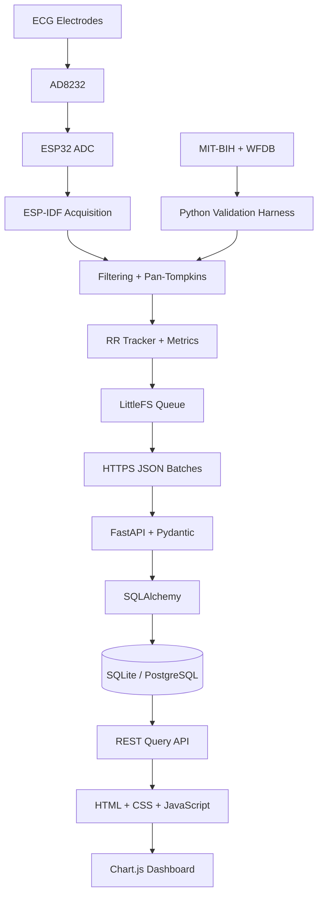

# EdgeECG — Product Requirements Document (PRD)

**Version:** 1.0  
**Date:** October 2026  
**Project duration:** 4–6 weeks  
**Project type:** Educational embedded systems and full-stack portfolio project  
**Primary objective:** Demonstrate embedded signal processing, reliable offline data synchronization, backend engineering, SQL, and reproducible ECG algorithm validation.

---

# 1. Overview

## 1.1 Product Summary

EdgeECG is a low-cost, wearable-style, single-lead ECG monitoring prototype built using an ESP32 microcontroller and an AD8232 ECG analog front end.

The device samples the ECG signal, filters noise, detects R-peaks using an embedded C implementation of the Pan–Tompkins algorithm, and calculates heart rate and a simple heart-rate variability (HRV) metric locally.

Measurements are stored in a persistent local queue and uploaded to a Python FastAPI backend using HTTPS and JSON batches. The backend authenticates devices, validates incoming data, prevents duplicate records, and stores measurements in an SQL database. A browser dashboard displays heart rate, HRV, historical trends, device connectivity, signal quality, and rule-based flags for unusual RR intervals.

The detection algorithm is evaluated against the public MIT-BIH Arrhythmia Database using a reproducible Python validation harness.

The project is intended for educational use, portfolio demonstrations, and engineering interviews. It is not a medical device and must not be used for diagnosis or clinical decision-making.

## 1.2 Vision

Build an inexpensive edge-processing system that continues collecting and analyzing ECG signals without internet connectivity and reliably synchronizes its results when the network returns.

The project should demonstrate meaningful engineering across embedded C, signal processing, persistent storage, networking, REST APIs, SQL, frontend development, and algorithm validation.

## 1.3 Problem Statement

Typical hobby ECG projects focus on reading an analog signal and plotting a waveform. They often lack reliable signal processing, persistent offline storage, duplicate-safe synchronization, historical queries, and reproducible validation.

EdgeECG addresses these limitations by implementing local processing, durable buffering, authenticated data ingestion, historical storage, and a transparent evaluation process.

## 1.4 Target Constraints

- One primary student developer.
- Four to six weeks of implementation.
- Hardware budget of approximately INR 3,000 or less.
- Existing ESP32 and AD8232 experience.
- Embedded C and basic Python/SQL knowledge.
- No requirement for medical certification.
- No mobile application.
- Every major algorithm and design decision must be explainable by the builder.

---

# 2. Goals and Non-Goals

## 2.1 Goals

| ID | Goal | Success Criterion |
|---|---|---|
| G-01 | Acquire ECG samples | Operate at a configured target of 250 Hz. |
| G-02 | Process ECG locally | Filtering and R-peak detection execute on the ESP32. |
| G-03 | Calculate heart rate | Produce valid BPM estimates from accepted RR intervals. |
| G-04 | Calculate HRV | Calculate rolling RMSSD in milliseconds from valid RR intervals. |
| G-05 | Operate offline | Continue acquisition and local processing for at least 10 minutes without Wi-Fi. |
| G-06 | Prevent data loss | Recover all committed, unacknowledged records in controlled restart tests. |
| G-07 | Prevent duplicates | Store one logical database record per device-and-sequence identity. |
| G-08 | Provide history | Query measurements by device and time range. |
| G-09 | Provide visualization | Display current metrics, trends, quality status, and interval flags. |
| G-10 | Validate detection | Publish measured sensitivity, positive predictive value, and F1 score. |
| G-11 | Stay within budget | Keep required hardware spending at or below INR 3,000. |
| G-12 | Deliver a portfolio artifact | Publish source code, README, architecture diagram, results table, and demonstration video. |

## 2.2 Non-Goals

The initial release will not include:

- Medical diagnosis or treatment recommendations.
- Disease classification or clinical arrhythmia detection.
- Medical-grade alarms.
- Multi-lead ECG acquisition.
- Android or iOS applications.
- Continuous cloud streaming of raw ECG samples.
- Machine-learning-based diagnosis.
- Custom PCB fabrication.
- Waterproofing or a certified wearable enclosure.
- Production-scale user management.
- Clinical trials or regulatory certification.
- Guaranteed recovery of records that were never durably committed before power loss.

The dashboard may flag unusual interval measurements but must not claim that these indicate a specific disease.

---

# 3. Users and Personas

## 3.1 Primary User: Student Builder

### Goals
- Complete the prototype in four to six weeks.
- Demonstrate embedded systems and software engineering skills.
- Understand and explain every major module.
- Produce reproducible test results.

### Pain Points
- Limited time and budget.
- Noise in analog ECG signals.
- Hardware and networking failures.
- Difficulty validating detection accuracy.
- Risk of spending too much time on frontend work.

### Requirements
- Modular code.
- Clear error messages and diagnostic counters.
- A software-only test path.
- Reproducible validation scripts.
- Documented hardware connections and interfaces.

## 3.2 Secondary User: Recruiter or Technical Interviewer

### Goals
- Understand the architecture quickly.
- Observe a working hardware-to-cloud pipeline.
- Verify offline synchronization.
- Inspect actual algorithm results.
- Evaluate the builder's technical understanding.

### Requirements
- Clear README.
- Architecture diagram.
- Short demonstration video.
- Automated tests.
- Measured results and known limitations.

## 3.3 Secondary User: Engineering Reviewer

A hardware or software engineering reviewer may inspect acquisition, signal quality, data handling, security, and extensibility.

The product must be presented as an educational prototype, not as a clinically validated ECG system.

---

# 4. User Stories

## Signal Processing

- As a builder, I want fixed-rate sampling so that the detector receives predictable input.
- As a builder, I want digital filtering so that noise has less influence on peak detection.
- As a builder, I want local R-peak detection so that internet access is unnecessary for processing.
- As a builder, I want valid heart-rate and RMSSD calculations.
- As a reviewer, I want signal-quality indicators so that unreliable estimates are identifiable.

## Offline Synchronization

- As a builder, I want persistent metric records so that network outages do not erase pending data.
- As a builder, I want sequence numbers so that missing or repeated records can be identified.
- As a device, I want to retry failed uploads without duplicating database records.
- As a device, I want to delete queued records only after server acknowledgement.

## Backend

- As a device, I want authenticated ingestion so that unauthorized devices cannot submit measurements.
- As a dashboard, I want paginated history so that records can be queried efficiently.
- As a reviewer, I want explicit API errors so that failures are diagnosable.

## Dashboard

- As a user, I want to see the latest heart rate and its timestamp.
- As a user, I want to inspect historical heart-rate trends.
- As a user, I want interval deviations flagged using documented rules.
- As a user, I want offline and stale-data states clearly displayed.

## Validation

- As a builder, I want to evaluate detections against MIT-BIH annotations.
- As a reviewer, I want measured detection metrics and the evaluation configuration.
- As a developer, I want automated tests for the detector, queue, and API.

---

# 5. Functional Requirements

Priority definitions:

- Must: required for the first release.
- Should: desirable if time permits.
- Could: optional enhancement.

## 5.1 Acquisition and Signal Processing

| ID | Priority | Requirement | Acceptance Criteria |
|---|---|---|---|
| FR-001 | Must | Sample the AD8232 output at a configured target of 250 Hz. | A 60-second run produces approximately 15,000 samples. |
| FR-002 | Must | Detect ADC saturation and invalid readings. | Invalid readings are counted and do not produce trusted metrics. |
| FR-003 | Must | Apply documented digital filters. | Coefficients and frequency response are documented and tested. |
| FR-004 | Must | Implement Pan–Tompkins-style QRS detection in C. | The detector processes samples on the ESP32 without unbounded memory growth. |
| FR-005 | Must | Record accepted R-peak positions. | Each peak has a sample index and timing reference. |
| FR-006 | Must | Calculate heart rate from valid RR intervals. | BPM equals 60,000 divided by RR in milliseconds. |
| FR-007 | Must | Calculate rolling RMSSD. | The output is in milliseconds and is unavailable when insufficient valid intervals exist. |
| FR-008 | Must | Reject implausible detections according to documented rules. | Rejections are counted and configurable thresholds are documented. |
| FR-009 | Must | Expose processing diagnostics over serial. | Logs show sampling health, metrics, and quality state. |
| FR-010 | Should | Provide a prerecorded-signal diagnostic mode. | The detector can be tested without connecting electrodes. |
| FR-011 | Could | Retain a short RAM waveform buffer. | The buffer has a fixed capacity and does not block acquisition. |

### Acquisition Constraints

The AD8232 is an analog front end, not a digital ECG sensor with a built-in ADC. The ESP32 samples its analog output.

The exact board variant, ADC range, attenuation, analog output voltage, and lead-off wiring must be verified before connecting the hardware.

The acquisition routine must not perform HTTP requests, database operations, or blocking serial output.

## 5.2 Offline Buffering and Synchronization

| ID | Priority | Requirement | Acceptance Criteria |
|---|---|---|---|
| FR-012 | Must | Assign each metric record a device ID, sequence number, session ID, and timestamp. | Logical record identity remains stable across retries and restarts. |
| FR-013 | Must | Persist pending records using LittleFS. | Previously committed queue records survive a controlled restart. |
| FR-014 | Must | Continue processing when Wi-Fi is unavailable. | A 10-minute outage does not stop local processing. |
| FR-015 | Must | Upload batches containing at most 100 records. | Oversized batches are split before transmission. |
| FR-016 | Must | Retry transient failures with exponential backoff and jitter. | Retry intervals increase and remain below a configured maximum. |
| FR-017 | Must | Make ingestion idempotent. | Replaying a batch ten times does not create duplicate rows. |
| FR-018 | Must | Remove queue records only after server acknowledgement. | Failed and unacknowledged records remain available for retry. |
| FR-019 | Must | Detect queue exhaustion. | Pending records are not silently overwritten. |
| FR-020 | Must | Recover synchronization state after restart. | Pending and acknowledged sequence identities remain distinguishable. |
| FR-021 | Should | Synchronize the wall clock using network time. | Timestamp synchronization status is recorded. |

Use LittleFS for queued records and ESP32 Preferences/NVS for small settings and persistent metadata where appropriate.

Do not repeatedly rewrite a single NVS value as a high-frequency record log.

## 5.3 Backend and Database

| ID | Priority | Requirement | Acceptance Criteria |
|---|---|---|---|
| FR-022 | Must | Implement authenticated batch ingestion. | Valid requests are accepted; invalid device credentials are rejected. |
| FR-023 | Must | Validate all incoming payloads. | Invalid fields and unsupported schema versions receive controlled errors. |
| FR-024 | Must | Enforce uniqueness on device ID and sequence number. | Concurrent duplicate requests cannot create duplicate records. |
| FR-025 | Must | Store metrics in SQL. | Records can be queried by device and timestamp. |
| FR-026 | Must | Provide paginated historical queries. | Queries return ordered records with stable cursors. |
| FR-027 | Must | Expose the latest measurement and device status. | The dashboard can display last-seen time. |
| FR-028 | Must | Log errors without exposing secrets. | Requests can be correlated with server logs. |
| FR-029 | Should | Provide a health endpoint. | Application and database health are reported without sensitive information. |
| FR-030 | Could | Provide CSV export. | An authorized query can export a selected time range. |

## 5.4 Dashboard

| ID | Priority | Requirement | Acceptance Criteria |
|---|---|---|---|
| FR-031 | Must | Display the latest uploaded heart rate. | The value includes its timestamp and age. |
| FR-032 | Must | Display historical heart-rate trends. | Users can select 1-hour, 24-hour, and 7-day windows. |
| FR-033 | Must | Display RMSSD in milliseconds. | Missing or invalid metrics are represented as unavailable. |
| FR-034 | Must | Display device connectivity and signal quality. | Stale data is distinguishable from current data. |
| FR-035 | Must | Flag unusual RR intervals using documented rules. | Each flag identifies the rule and triggering values. |
| FR-036 | Must | Avoid diagnostic claims. | No disease diagnosis or treatment advice appears in the UI. |
| FR-037 | Must | Implement empty and error states. | No-data, offline, authentication-error, and backend-error states are handled. |
| FR-038 | Should | Automatically refresh metrics. | The dashboard polls the backend every five seconds by default. |
| FR-039 | Could | Display detector diagnostics. | A development view shows rejected peaks and sampling overruns. |

## 5.5 Validation and Delivery

| ID | Priority | Requirement | Acceptance Criteria |
|---|---|---|---|
| FR-040 | Must | Evaluate QRS detection using MIT-BIH annotations. | The evaluation script runs against documented records. |
| FR-041 | Must | Calculate sensitivity, PPV, and F1. | Metrics are derived from TP, FP, and FN counts. |
| FR-042 | Must | Document the evaluation configuration. | Sampling rate, matching tolerance, and exclusions are recorded. |
| FR-043 | Must | Include automated tests. | Detector utilities, API validation, deduplication, and history queries are tested. |
| FR-044 | Must | Include README and architecture documentation. | A fresh checkout can be built and tested using documented steps. |
| FR-045 | Must | Produce a demonstration video. | The video shows acquisition, offline operation, synchronization, and history. |
| FR-046 | Must | Publish measured results. | The results table contains actual measurements, not invented values. |
| FR-047 | Should | Provide repeatable build and test commands. | Documented commands reproduce the firmware build and backend tests. |

---

# 6. Non-Functional Requirements

| ID | Category | Requirement | Verification |
|---|---|---|---|
| NFR-001 | Performance | Target 250 Hz sampling without sustained overruns during a 30-minute test. | Timing counters. |
| NFR-002 | Performance | Keep detector processing within the 4 ms sampling interval under normal load. | GPIO timing or cycle measurements. |
| NFR-003 | Reliability | Continue acquisition for at least 10 minutes without Wi-Fi. | Hardware-in-the-loop test. |
| NFR-004 | Reliability | Recover every committed, unacknowledged queue record in controlled restart tests. | Sequence comparison. |
| NFR-005 | Reliability | Prevent duplicate database rows under retries. | Repeated ingestion tests. |
| NFR-006 | Performance | Target a batch upload time under five seconds for 100 records on a stable local network. | Integration tests. |
| NFR-007 | Security | Use HTTPS for public backend communication. | TLS verification. |
| NFR-008 | Security | Store only hashed device credentials on the server. | Database inspection. |
| NFR-009 | Security | Keep secrets out of source control and logs. | Repository and log review. |
| NFR-010 | Security | Enforce request-body and batch-size limits. | Oversized request tests. |
| NFR-011 | Privacy | Avoid collecting unnecessary identifying information. | Schema review. |
| NFR-012 | Power | Use USB power for the initial prototype. | Bench test. |
| NFR-013 | Power | Measure average current during acquisition and synchronization. | Current measurement. |
| NFR-014 | Safety | Do not use the prototype for clinical decisions. | README and UI review. |
| NFR-015 | Scalability | Support at least 10,000 stored metric records with bounded queries. | Database seed test. |
| NFR-016 | Maintainability | Separate acquisition, processing, persistence, networking, API, and UI modules. | Code review. |
| NFR-017 | Reproducibility | Include dependency versions and evaluation configuration. | Clean-environment rerun. |

## 6.1 Electrical Safety

The initial setup must be treated as a development circuit, not a medically isolated ECG device.

Use simulated signals or prerecorded data for early validation. Do not attach electrodes to a person while the prototype is connected to a mains-powered computer or other electrically connected equipment unless the entire setup has been appropriately assessed for electrical safety.

The default prototype should be USB-powered for bench testing and should not claim clinical suitability.

---

# 7. System Architecture

## 7.1 Hardware Layer

Components:

- ESP32 development board.
- AD8232 ECG analog front end.
- Compatible ECG electrode cable and electrodes.
- Breadboard and jumper wires.
- USB data/power cable.

Responsibilities:

- Acquire the analog ECG output.
- Supply the required processing and connectivity resources.
- Provide a stable, documented electrical interface.

## 7.2 Firmware Layer

Technology: C with ESP-IDF.

Modules:

- Acquisition.
- Digital filtering.
- Pan–Tompkins detection.
- RR interval tracking.
- Heart-rate calculation.
- RMSSD calculation.
- Signal-quality evaluation.
- Persistent queue.
- HTTPS synchronization.
- Device configuration.

The acquisition path must be independent of blocking network operations.

## 7.3 Backend Layer

Technology: Python, FastAPI, Pydantic, SQLAlchemy.

Responsibilities:

- Authenticate devices.
- Validate payloads.
- Deduplicate records.
- Persist metrics.
- Serve historical queries.
- Expose device status.
- Return structured errors.

## 7.4 Database Layer

Initial database: SQLite.

Optional deployment database: PostgreSQL.

The database must enforce unique logical record identity and support time-range queries.

## 7.5 Dashboard Layer

Technology:

- HTML.
- CSS.
- JavaScript.
- Chart.js.

The dashboard is served by FastAPI or hosted as static files.

Responsibilities:

- Display the latest heart rate.
- Display RMSSD.
- Display historical trends.
- Display device connectivity.
- Display signal quality.
- Display rule-based interval flags.
- Handle empty, stale, and error states.

React is intentionally excluded from the initial implementation to reduce frontend complexity.

## 7.6 Validation Layer

Technology:

- Python.
- NumPy.
- SciPy.
- WFDB.
- MIT-BIH Arrhythmia Database.

The validation harness must evaluate the same detector logic used by the firmware, preferably through a shared C implementation or common golden test vectors.

## 7.7 Architecture Diagram



---

# 8. Hardware Bill of Materials

Prices are estimates and must be verified with suppliers.

| Component | Purpose | Quantity | Estimated Cost | Notes |
|---|---|---:|---:|---|
| ESP32 development board | Processing and Wi-Fi | 1 | INR 400–700 | Verify board variant and pinout. |
| AD8232 ECG module | Analog signal conditioning | 1 | INR 250–500 | Verify output range and wiring. |
| ECG electrode leads | Connect electrodes to module | 1 set | INR 150–300 | Check whether included with module. |
| Disposable ECG electrodes | Electrode interface | 1 pack | INR 100–250 | Verify connector compatibility. |
| Breadboard | Temporary circuit assembly | 1 | INR 80–150 | No custom PCB required. |
| Jumper wires | Electrical connections | 1 set | INR 60–120 | Verify connector types. |
| USB data/power cable | Power and serial development | 1 | INR 100–200 | May already be available. |
| Optional battery and charger | Portable power | 0–1 | INR 300–700 | Excluded from initial build. |
| Optional enclosure | Physical protection | 0–1 | INR 100–300 | Excluded from initial build. |

**Estimated core parts total:** INR 1,140–2,220.

The initial build must remain functional without a battery or custom enclosure.

---

# 9. Firmware and Software Design

## 9.1 Recommended Repository Structure

```text
edgeecg/
├── firmware/
│   ├── main/
│   │   ├── main.c
│   │   ├── acquisition.c
│   │   ├── filters.c
│   │   ├── pan_tompkins.c
│   │   ├── rr_tracker.c
│   │   ├── metrics.c
│   │   ├── signal_quality.c
│   │   ├── persistent_queue.c
│   │   └── sync_client.c
│   ├── include/
│   ├── test/
│   └── CMakeLists.txt
├── backend/
│   ├── app/
│   │   ├── main.py
│   │   ├── auth.py
│   │   ├── schemas.py
│   │   ├── database.py
│   │   ├── ingestion.py
│   │   ├── queries.py
│   │   └── metrics.py
│   ├── tests/
│   ├── migrations/
│   └── requirements.txt
├── dashboard/
│   ├── index.html
│   ├── styles.css
│   └── app.js
├── validation/
│   ├── evaluate.py
│   ├── matching.py
│   ├── config.yaml
│   └── results/
├── docs/
│   ├── architecture.md
│   ├── wiring.md
│   ├── validation.md
│   └── safety.md
├── README.md
├── PRD.md
└── LICENSE
```

## 9.2 Sampling

Target sampling rate: 250 Hz.

The sampling interval is 4 ms.

The acquisition routine should:

- Use an ESP-IDF hardware timer or an appropriately configured sampling task.
- Read the ADC.
- Increment a monotonic sample counter.
- Associate samples with a recoverable timing reference.
- Push samples into a bounded ring buffer.
- Count sampling overruns.
- Avoid network calls and blocking logging.

Sampling-rate and jitter measurements must be documented.

## 9.3 Signal Processing

Implement a documented Pan–Tompkins-style pipeline:

1. Band-pass filtering.
2. Derivative.
3. Squaring.
4. Moving-window integration.
5. Adaptive thresholding.
6. Refractory-period handling.
7. Search-back or recovery logic, if implemented.
8. Localization of the R-peak in the original filtered ECG signal.

Filter coefficients must be appropriate for the configured sampling rate.

The implementation must account for filter and integration delay before reporting peak timestamps.

## 9.4 Heart Rate

For successive accepted peak times:

RR interval = current R-peak timestamp minus previous R-peak timestamp.

Heart rate:

HR in BPM = 60,000 / RR interval in milliseconds.

Invalid intervals must not be used as trusted heart-rate estimates.

## 9.5 HRV

Calculate rolling RMSSD:

RMSSD = square root of the mean of squared successive differences between adjacent RR intervals.

The initial configuration may use a 60-second rolling window and require at least 10 valid RR intervals before publishing an estimate.

This is a project configuration, not a clinical standard.

The implementation must document:

- Window duration.
- Minimum interval count.
- Interval rejection rules.
- Missing-data behavior.
- Signal-quality requirements.

## 9.6 Persistent Queue

Each logical metric record contains:

- Schema version.
- Device ID.
- Session ID.
- Sequence number.
- Event timestamp.
- Timestamp synchronization status.
- Heart rate.
- RMSSD.
- Latest accepted RR interval.
- Signal-quality state.
- Detector diagnostic counters.

The unique identity is `(device_id, sequence)`.

The queue must distinguish pending, in-flight, acknowledged, and removed records.

A successful network write is not equivalent to a committed server record. The queue can remove a record only after the server confirms that it has been stored or was already present.

## 9.7 Backend Dependencies

Recommended dependencies:

- FastAPI.
- Pydantic.
- SQLAlchemy.
- Alembic, if migrations are required.
- SQLite driver for local development.
- PostgreSQL driver if deployed with PostgreSQL.
- Pytest.
- HTTP test client.

## 9.8 Dashboard Dependencies

- HTML5.
- CSS.
- Vanilla JavaScript.
- Chart.js.

Use the backend as the source of truth. Do not calculate or fabricate the latest device measurements using hardcoded frontend data.

---

# 10. APIs and Integrations

## 10.1 API Conventions

- Base path: `/api/v1`.
- Transport: HTTPS in public deployments.
- Format: JSON.
- Authentication: `X-Device-Key` for device ingestion.
- Maximum batch size: 100 records.
- Timestamps: UTC epoch milliseconds.
- Request validation: Pydantic.
- SQL access: SQLAlchemy or parameterized SQL.
- Database identity: unique device-and-sequence pair.

Device credentials must be separate from dashboard read authorization.

## 10.2 Ingestion Endpoint

`POST /api/v1/ingest`

Example request:

```json
{
  "schema_version": 1,
  "device_id": "edgeecg-001",
  "records": [
    {
      "sequence": 1042,
      "session_id": "boot-session-uuid",
      "timestamp_ms": 1792533600000,
      "heart_rate_bpm": 72.4,
      "rmssd_ms": 31.8,
      "rr_interval_ms": 831.0,
      "signal_quality": "valid",
      "detected_peaks": 12,
      "rejected_peaks": 1
    }
  ]
}
```

These values are illustrative, not measured results.

Example response:

```json
{
  "status": "accepted",
  "accepted_sequences": [1042],
  "duplicate_sequences": [],
  "rejected_records": []
}
```

The backend must commit the database transaction before acknowledging records.

Repeated submissions must not create duplicate rows.

## 10.3 API Endpoints

| Method | Endpoint | Purpose |
|---|---|---|
| POST | `/api/v1/ingest` | Upload metric batches. |
| GET | `/api/v1/devices/me` | Return authenticated device status. |
| GET | `/api/v1/devices/{device_id}/latest` | Retrieve latest metrics. |
| GET | `/api/v1/devices/{device_id}/records` | Retrieve paginated history. |
| GET | `/api/v1/devices/{device_id}/flags` | Retrieve interval flags. |
| GET | `/health` | Check application health. |

Dashboard endpoints must enforce authorization independently of device ingestion credentials.

## 10.4 Error Handling

| HTTP Status | Condition | Expected Behavior |
|---|---|---|
| 400 | Malformed request | Retain queued records and log the error. |
| 401 | Invalid device key | Retain records and stop rapid retries. |
| 403 | Device disabled | Retain records and report configuration failure. |
| 413 | Batch too large | Split the batch and retry. |
| 422 | Invalid record | Report the affected record or reject the batch according to the documented transaction policy. |
| 429 | Rate limited | Retry with backoff. |
| 500/503 | Server unavailable | Retain records and retry later. |

## 10.5 SQL Schema

### devices

- `id`: primary key.
- `key_hash`: hash of device credential.
- `created_at`: registration timestamp.
- `last_seen_at`: last successful ingestion timestamp.
- `active`: device status.

### metric_records

- `id`: primary key.
- `device_id`: foreign key.
- `sequence`: monotonic sequence number.
- `session_id`: firmware session identifier.
- `timestamp`: event time.
- `received_at`: server receipt time.
- `heart_rate_bpm`: nullable numeric.
- `rmssd_ms`: nullable numeric.
- `rr_interval_ms`: nullable numeric.
- `signal_quality`: status.
- `detected_peaks`: integer.
- `rejected_peaks`: integer.
- `schema_version`: integer.

Required constraints:

- Unique `(device_id, sequence)`.
- Index on `(device_id, timestamp)`.
- Index on `(device_id, sequence)`.
- Non-negative diagnostic counts.
- Nullable metrics for invalid measurements.

---

# 11. UX and User Flows

## 11.1 Dashboard Components

The dashboard must contain:

1. Latest heart rate.
2. Latest RMSSD.
3. Last synchronization time.
4. Device connectivity status.
5. Signal-quality state.
6. Heart-rate trend chart.
7. Selectable 1-hour, 24-hour, and 7-day history.
8. Interval deviation flags.
9. Loading, empty, stale-data, and error states.

## 11.2 First-Time Setup

1. Flash firmware.
2. Configure Wi-Fi and backend URL.
3. Provision a device key.
4. Start the backend and database.
5. Open the dashboard.
6. Verify acquisition through serial logs.
7. Confirm that the first uploaded measurement appears in history.

Success criterion: the dashboard displays either real data or a clear no-data state.

## 11.3 Normal Operation

1. ESP32 samples the signal.
2. Firmware filters and processes samples.
3. Metrics are calculated.
4. Records are written to LittleFS.
5. The uploader sends pending batches.
6. The backend validates and stores records.
7. The dashboard refreshes its data.
8. Historical queries return stored measurements.

## 11.4 Offline Operation

1. Wi-Fi disconnects.
2. Local acquisition and processing continue.
3. New records remain in the persistent queue.
4. Dashboard data is marked stale.
5. Connectivity returns.
6. The uploader retries pending batches.
7. The backend acknowledges records.
8. The device advances its acknowledgement checkpoint.

Success criterion: all committed, unacknowledged records survive the controlled outage test and are eventually synchronized.

## 11.5 Signal-Quality Failure

1. The signal becomes noisy or invalid.
2. Firmware changes the quality state.
3. Invalid metrics are marked unavailable.
4. The dashboard displays the quality issue.
5. The system does not label the condition as a confirmed arrhythmia.

## 11.6 Required Error States

| State | Display |
|---|---|
| No data | No measurements received yet. |
| Offline | Device has not synced recently. |
| Invalid signal | Signal quality insufficient for a reliable estimate. |
| Empty history | No data in this time range. |
| Backend unavailable | Unable to load measurements. |
| Authentication failure | Device authentication failed. |
| Queue full | Local storage capacity reached. |
| Invalid record | Record requires investigation. |

---

# 12. Edge Cases and Failure Modes

| ID | Failure | Expected Behavior |
|---|---|---|
| E-001 | ADC saturated | Mark signal invalid and increment diagnostics. |
| E-002 | Electrode disconnected | Use lead-off detection if supported by the selected module. |
| E-003 | Baseline drift | Apply filtering and reject unreliable detections. |
| E-004 | Motion artifact | Mark degraded quality when detectable. |
| E-005 | Missed peak | Apply documented recovery rules and count the missed detection during validation. |
| E-006 | False peak | Apply configured rejection rules and count false positives in validation. |
| E-007 | Sampling overrun | Increment the counter and invalidate affected timing if necessary. |
| E-008 | Device restart | Recover queue state and initialize a new session ID. |
| E-009 | Interrupted queue write | Ignore or quarantine incomplete trailing records. |
| E-010 | Wi-Fi unavailable | Continue local processing and queue records. |
| E-011 | Backend unavailable | Retain records and retry. |
| E-012 | Timeout after database commit | Retry safely using idempotent ingestion. |
| E-013 | Duplicate batch | Acknowledge records already stored. |
| E-014 | Invalid payload | Return a controlled error without silent deletion. |
| E-015 | Clock unsynchronized | Preserve sequence order and mark timestamp uncertainty. |
| E-016 | Clock moves backwards | Use sequence identity rather than wall-clock time for deduplication. |
| E-017 | Queue full | Report overflow without silently overwriting pending records. |
| E-018 | Invalid credentials | Retain the queue and stop rapid retries. |
| E-019 | Rate limit | Back off before retrying. |
| E-020 | Database failure | Do not acknowledge uncommitted records. |
| E-021 | No historical data | Display an empty state. |
| E-022 | Invalid API response | Display a controlled error. |
| E-023 | Oversized request | Reject before excessive processing. |
| E-024 | Annotation mismatch | Fail the evaluation or document the exclusion. |
| E-025 | Poor benchmark results | Report actual results and inspect per-record errors. |

## 12.1 Queue Overflow

The initial target is 24 hours of metric-record buffering, subject to measured storage capacity.

The queue must expose:

- Queue depth.
- Oldest pending sequence.
- Latest generated sequence.
- Last acknowledged sequence.
- Queue corruption and overflow counters.

If storage fills, the system must report the failure. It must not silently overwrite unacknowledged records.

---

# 13. Test and Validation Plan

## 13.1 Unit Tests

| ID | Module | Test | Pass Criteria |
|---|---|---|---|
| UT-001 | Acquisition | Sampling cadence | No sustained overruns in the timing test. |
| UT-002 | Filters | Synthetic noise input | Output matches documented filter behavior within tolerance. |
| UT-003 | Detector | Known synthetic peaks | Matches reference locations within configured tolerance. |
| UT-004 | Detector | Noise-only input | No uncontrolled stream of detections. |
| UT-005 | RR tracker | Known timestamps | Correct interval calculations. |
| UT-006 | Heart rate | RR = 1,000 ms | Result = 60 BPM. |
| UT-007 | HRV | Known RR sequence | RMSSD matches an independent calculation. |
| UT-008 | Queue | Restart recovery | All committed records are recovered. |
| UT-009 | Queue | Interrupted write | Earlier records remain valid. |
| UT-010 | Retry | Repeated failures | Backoff increases and is bounded. |
| UT-011 | API | Invalid payloads | Controlled 4xx responses. |
| UT-012 | API | Repeated batches | One logical row per record identity. |
| UT-013 | API | Pagination | No skipped or repeated records during stable traversal. |
| UT-014 | Security | Invalid credentials | Ingestion is rejected. |

## 13.2 Integration Tests

- Device uploads a batch and all records become queryable.
- Repeated requests do not create duplicates.
- A database failure does not produce a successful acknowledgement.
- Out-of-order batches remain identifiable by sequence.
- Invalid timestamps are rejected.
- Dashboard empty states work.
- Dashboard values match the API response.
- Backend failure produces a controlled UI error.

## 13.3 Hardware-in-the-Loop Tests

| ID | Procedure | Pass Criteria |
|---|---|---|
| HIL-001 | Start ESP32 and AD8232 | Acquisition begins without persistent ADC errors. |
| HIL-002 | Feed a suitable simulated ECG signal | Peaks are repeatable within the configured tolerance. |
| HIL-003 | Run for 30 minutes | No unexplained reset or sustained sampling overrun. |
| HIL-004 | Disconnect Wi-Fi for 10 minutes | Local acquisition and processing continue. |
| HIL-005 | Restore Wi-Fi | Pending records are acknowledged and synchronized. |
| HIL-006 | Restart with pending records | Queue and sequence identities recover. |
| HIL-007 | Stop backend during upload | Pending records remain available. |
| HIL-008 | Upload during acquisition | Sampling continues without network-induced blocking. |
| HIL-009 | Exhaust queue capacity in a controlled test | Overflow is reported and pending records are not silently overwritten. |

## 13.4 MIT-BIH Validation

### Dataset

Use the MIT-BIH Arrhythmia Database from PhysioNet.

The database contains 48 approximately half-hour, two-channel ECG recordings sampled at 360 Hz.

Official dataset:

https://physionet.org/content/mitdb/1.0.0/

### Evaluation Target

Evaluate QRS/R-peak detection, not disease classification.

### Sampling-Rate Handling

The intended device sample rate is 250 Hz, while MIT-BIH is sampled at 360 Hz.

Resample the ECG to 250 Hz using a documented anti-aliasing procedure, or explicitly evaluate at 360 Hz and document the difference.

Reference annotation timestamps must be converted consistently. Never compare sample indices from different sampling rates directly.

### Evaluation Procedure

1. Select development records.
2. Select a held-out evaluation set.
3. Fix the record list before final tuning.
4. Read signals and annotations using WFDB.
5. Apply the documented resampling method.
6. Run the detector.
7. Match detected peaks to reference annotations using one-to-one matching.
8. Use an initial matching tolerance of ±100 ms.
9. Count unmatched reference beats as false negatives.
10. Count unmatched detections as false positives.
11. Calculate aggregate and per-record metrics.
12. Publish the configuration and results.

A ±50 ms sensitivity analysis is recommended.

The evaluation harness should call the same C detector implementation used by the ESP32 where feasible. If a separate Python implementation is used, verify equivalence using common test vectors.

### Metrics

Sensitivity:

Sensitivity = TP / (TP + FN)

Positive predictive value:

PPV = TP / (TP + FP)

F1 score:

F1 = 2 × TP / (2 × TP + FP + FN)

Where:

- TP: correctly matched detections.
- FP: unmatched detections.
- FN: missed reference beats.

Do not report specificity unless a defensible true-negative definition has been implemented.

### Results Table

| Record / Split | Reference Beats | TP | FP | FN | Sensitivity | PPV | F1 |
|---|---:|---:|---:|---:|---:|---:|---:|
| Development subset | Pending | Pending | Pending | Pending | Pending | Pending | Pending |
| Held-out subset | Pending | Pending | Pending | Pending | Pending | Pending | Pending |
| Aggregate | Pending | Pending | Pending | Pending | Pending | Pending | Pending |

The initial engineering target is at least 95% sensitivity and 95% PPV on the documented evaluation set. These are targets, not known results or clinical guarantees.

The final README must include record IDs, exclusions, sampling rate, resampling method, matching tolerance, detector parameters, aggregate counts, and limitations.

## 13.5 Dashboard Usability Test

Ask two or three people who did not build the dashboard to:

1. Identify the latest heart rate.
2. Find the last synchronization time.
3. Open the 24-hour history.
4. Find an interval flag.
5. Distinguish an offline device from an invalid signal.

Pass criterion: all tasks are completed without developer intervention.

---

# 14. Success Metrics

| Metric | Target | Measurement |
|---|---|---|
| Sampling stability | 30-minute bench run without sustained overruns | Firmware counters. |
| Sampling rate | Configured target of 250 Hz | Sample count and elapsed time. |
| Detection sensitivity | Initial target >=95% | MIT-BIH evaluator. |
| Detection PPV | Initial target >=95% | MIT-BIH evaluator. |
| F1 score | Calculated and reported; initial target >=95% | MIT-BIH evaluator. |
| Offline operation | At least 10 minutes | Hardware test. |
| Queue recovery | 100% of committed unacknowledged records in controlled tests | Sequence comparison. |
| Duplicate prevention | One logical row after ten repeated submissions | SQL integration test. |
| Reconnection | Pending queue eventually drains | Queue and acknowledgement logs. |
| Dashboard refresh | Five-second polling interval | Browser and API timestamps. |
| Authentication | Invalid credentials rejected | Security tests. |
| Budget | <= INR 3,000 for required hardware | Purchase records. |
| Reproducibility | Clean setup succeeds | README checklist. |
| Interview demonstration | Complete five-minute walkthrough | Recorded practice demonstration. |

Any target that is not achieved must be reported honestly.

---

# 15. Milestones and Timeline

## Week 1: Hardware and Acquisition

Tasks:
- Finalize the BOM.
- Verify module wiring.
- Configure ESP-IDF.
- Acquire ADC samples.
- Verify timing and signal range.
- Create synthetic test vectors.

Deliverables:
- Working acquisition firmware.
- Wiring diagram.
- Basic timing report.

Exit criteria:
- Stable sample stream.
- No persistent acquisition errors.

## Week 2: Signal Processing

Tasks:
- Implement digital filtering.
- Implement Pan–Tompkins detection.
- Track RR intervals.
- Calculate heart rate and RMSSD.
- Implement validity rules.

Deliverables:
- Embedded detector.
- Metric calculation module.
- Synthetic unit tests.

Exit criteria:
- Known synthetic signals produce expected results.
- Invalid metrics are handled correctly.

## Week 3: Offline Queue and Backend

Tasks:
- Implement LittleFS queue.
- Implement sequence identity.
- Implement HTTPS upload.
- Build FastAPI ingestion.
- Implement device authentication.
- Create SQLite schema.
- Enforce idempotency.

Deliverables:
- Working ingestion API.
- Persistent queue.
- Database schema.

Exit criteria:
- Ten-minute outage test passes.
- Duplicate requests do not create duplicate records.

## Week 4: Dashboard

Tasks:
- Build HTML/CSS/JavaScript UI.
- Add Chart.js.
- Connect history API.
- Display current metrics.
- Add connection and quality states.
- Implement interval flags.

Deliverables:
- Working browser dashboard.

Exit criteria:
- End-to-end measurements appear in history.
- Empty and error states work.

## Week 5: Validation and Hardening

Tasks:
- Run MIT-BIH evaluation.
- Add backend integration tests.
- Test restart recovery.
- Test upload failures.
- Measure timing and storage capacity.
- Inspect detector errors.

Deliverables:
- Validation script.
- Results table.
- Test reports.

Exit criteria:
- Final evaluation has been executed.
- Limitations are documented.

## Week 6: Release and Presentation

Tasks:
- Fix critical defects.
- Complete README.
- Finalize architecture diagram.
- Verify clean setup instructions.
- Record demonstration video.
- Publish the repository.

Deliverables:
- GitHub repository.
- Demo video.
- Results table.
- Final documentation.

### Compressed Four-Week Option

If only four weeks are available, prioritize acquisition and signal processing in Week 1, offline synchronization and backend in Week 2, dashboard in Week 3, and validation/documentation in Week 4.

Optional battery, enclosure, raw waveform storage, and advanced UI features must be deferred.

---

# 16. Roles and Responsibilities

| Workstream | Owner | Responsibilities |
|---|---|---|
| Product and architecture | Builder | Scope, design, interfaces, documentation. |
| Hardware | Builder | Wiring, acquisition, signal quality. |
| Firmware | Builder | Sampling, filtering, detection, metrics, queue. |
| Backend | Builder | FastAPI, authentication, SQL, idempotency. |
| Dashboard | Builder | HTML, CSS, JavaScript, Chart.js. |
| Validation | Builder | MIT-BIH evaluation and results. |
| Documentation | Builder | README, diagram, wiring and safety notes. |
| Independent review | Optional peer | Wiring review, test reproduction, UI feedback. |

The default plan assumes one builder.

If a friend participates, assign explicit ownership of independent deliverables. One person must own final integration and API compatibility.

---

# 17. Risks and Mitigations

| Rank | Risk | Likelihood | Impact | Mitigation |
|---:|---|---|---|---|
| 1 | Poor signal quality | High | High | Validate wiring, ADC range, filtering, and simulated signals early. |
| 2 | Detector implementation takes too long | High | High | Implement stages independently and use synthetic test vectors. |
| 3 | Queue corruption or duplicates | Medium | High | Use persistent records, checkpoints, database uniqueness, and restart tests. |
| 4 | Network operations block acquisition | Medium | High | Separate acquisition and networking; measure timing. |
| 5 | Benchmark performance below target | Medium | High | Inspect per-record errors and report actual results. |
| 6 | Hardware incompatibility or delay | Medium | High | Verify module pinout and build a software test harness in parallel. |
| 7 | Timestamp errors | Medium | Medium | Use monotonic timing for intervals and UTC wall time for history. |
| 8 | Flash capacity insufficient | Medium | High | Measure record size and usable storage before claiming 24-hour buffering. |
| 9 | Credentials exposed | Low–Medium | High | Use environment variables, HTTPS, separate authorization, and key rotation. |
| 10 | Budget exceeded | Low–Medium | Medium | Omit optional battery and enclosure. |
| 11 | Scope expands into diagnosis | Medium | High | Keep flags rule-based and explicitly non-diagnostic. |
| 12 | Integration delayed | High | High | Freeze the API schema early and test each layer independently. |
| 13 | Desktop and firmware detectors differ | Medium | High | Share C code or use common golden test vectors. |
| 14 | Documentation delayed | Medium | Medium | Update the README incrementally. |

---

# 18. Assumptions and Open Questions

## 18.1 Assumptions

| ID | Assumption | Default |
|---|---|---|
| A-01 | Hardware | ESP32 development board and AD8232 module. |
| A-02 | Firmware | ESP-IDF with C modules. |
| A-03 | Sample rate | 250 Hz target. |
| A-04 | Detector | Embedded Pan–Tompkins-style implementation. |
| A-05 | Queue | LittleFS persistent metric queue. |
| A-06 | Communication | HTTPS REST and JSON batches. |
| A-07 | Backend | Python FastAPI and Pydantic. |
| A-08 | Database | SQLite locally; PostgreSQL optional. |
| A-09 | Dashboard | HTML, CSS, JavaScript and Chart.js. |
| A-10 | Validation | MIT-BIH with WFDB and Python. |
| A-11 | Matching tolerance | Initial ±100 ms. |
| A-12 | Offline duration | Ten-minute acceptance test; 24-hour storage target subject to capacity. |
| A-13 | Authentication | Unique device key. |
| A-14 | Deployment | Optional public hosting. |
| A-15 | Collaboration | One primary builder; peer review optional. |
| A-16 | Raw ECG upload | Excluded from initial release. |

## 18.2 Decisions to Finalize

1. Exact ESP32 board and flash capacity.
2. Exact AD8232 module and wiring.
3. Final filter coefficients and detector thresholds.
4. Persistent queue record format and recovery protocol.
5. Whether the backend will be local-only or publicly deployed.
6. Development and held-out MIT-BIH record lists.
7. Dashboard read-access mechanism.
8. Final hardware costs and supplier availability.

## 18.3 Known Limitations

- Hardware signal quality depends on the exact module and electrical setup.
- ESP32 ADC behavior must be measured on the selected board.
- Detection performance is unknown until evaluation.
- Public-dataset results do not establish performance on signals acquired by the prototype.
- Irregular RR intervals are not equivalent to a clinical diagnosis.
- The system has not been clinically validated or certified.
- Cost estimates may change with supplier availability and shipping.

---

# 19. Appendix

## 19.1 Glossary

| Term | Meaning |
|---|---|
| ECG | Electrocardiogram. |
| ADC | Analog-to-digital converter. |
| QRS | ECG waveform component associated with ventricular depolarization. |
| R-peak | Reference peak used for beat-to-beat timing. |
| RR interval | Time between successive accepted R-peaks. |
| HR | Heart rate in beats per minute. |
| HRV | Heart-rate variability. |
| RMSSD | Root mean square of successive RR interval differences. |
| Pan–Tompkins | QRS detection algorithm. |
| LittleFS | Flash filesystem suitable for persistent local files. |
| Idempotency | Repeated logical requests do not create repeated effects. |
| PPV | Positive predictive value, also called precision. |
| HIL | Hardware-in-the-loop testing. |
| WFDB | Tools for reading and processing waveform records and annotations. |
| MIT-BIH | Public annotated ECG database. |

## 19.2 References

1. MIT-BIH Arrhythmia Database: https://physionet.org/content/mitdb/1.0.0/
2. Pan, J. and Tompkins, W. J. (1985). "A Real-Time QRS Detection Algorithm." IEEE Transactions on Biomedical Engineering, 32(3), 230–236.
3. ESP-IDF documentation: https://docs.espressif.com/projects/esp-idf/en/stable/esp32/
4. ESP32 Preferences documentation: https://docs.espressif.com/projects/arduino-esp32/en/latest/api/preferences.html
5. FastAPI documentation: https://fastapi.tiangolo.com/
6. SQLAlchemy documentation: https://docs.sqlalchemy.org/
7. WFDB Python documentation: https://wfdb.readthedocs.io/
8. AD8232 product documentation: https://www.analog.com/en/products/ad8232.html

## 19.3 Required Repository Artifacts

- README.md
- PRD.md
- Architecture diagram
- Verified wiring diagram
- Firmware source code
- Backend source code
- Dashboard source code
- Automated tests
- MIT-BIH evaluation script
- Measured results table
- Safety disclaimer
- Demonstration video
- Dependency and license documentation

Do not commit device keys, database passwords, personal ECG recordings, or unsupported accuracy claims.

---

# 20. Next Steps

1. Finalize the exact ESP32 and AD8232 hardware and confirm the complete BOM is within INR 3,000.
2. Set up the ESP-IDF project and verify stable ADC acquisition.
3. Implement and test filtering, Pan–Tompkins detection, heart rate, and RMSSD.
4. Build the LittleFS queue and duplicate-safe FastAPI/SQLite ingestion pipeline.
5. Complete the dashboard, MIT-BIH validation, README, architecture diagram, and demonstration video.

**Definition of Done:** A reviewer can reproduce the build, observe local ECG processing, disconnect Wi-Fi without stopping acquisition, restore connectivity without duplicating committed records, inspect stored measurements on the dashboard, and reproduce the published detection metrics. The prototype must not make medical-performance claims.
