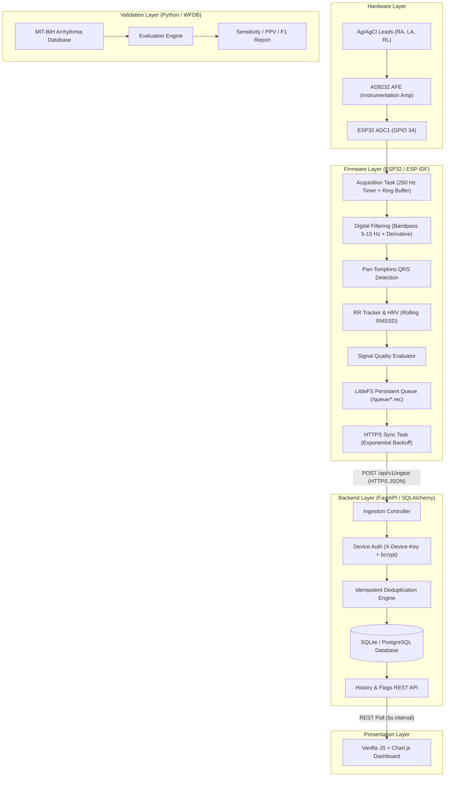

# EdgeECG — Embedded Physiological Telemetry & Offline-First ECG Monitor

[](LICENSE)
[](firmware/)
[](backend/)
[](validation/)

EdgeECG is an educational embedded systems and full-stack portfolio prototype. It demonstrates real-time ECG signal acquisition, digital signal processing (Pan–Tompkins QRS detection), heart rate variability (rolling RMSSD) estimation on an ESP32 microcontroller, durable offline queue persistence via LittleFS, and duplicate-safe HTTPS synchronization to a FastAPI/SQL backend with a modern browser dashboard.

> [!CAUTION]
> **EDUCATIONAL USE ONLY:** EdgeECG is not a medical device and is not cleared for clinical diagnosis, patient monitoring, or treatment decision-making. Please read the [Safety Guidelines](docs/safety.md).

---

## 1. System Architecture



---

## 2. Hardware Bill of Materials (BOM &lt; INR 3,000)

| Component | Description | Quantity | Est. Cost (INR) |
|:---|:---|:---:|:---:|
| **ESP32 DevKit V1** | Dual-core Tensilica Xtensa 240MHz, Wi-Fi/BLE | 1 | ₹450 – ₹650 |
| **AD8232 Module** | Single-lead ECG Analog Front End | 1 | ₹300 – ₹450 |
| **ECG Cable &amp; Leads** | 3.5mm jack to 3-lead snap connectors | 1 set | ₹200 – ₹300 |
| **Ag/AgCl Electrodes** | Disposable pre-gelled surface electrodes | 1 pack (10-30 pcs) | ₹150 – ₹250 |
| **Breadboard &amp; Jumpers** | Prototyping assembly | 1 set | ₹120 – ₹180 |
| **USB Cable** | Data &amp; isolated battery power | 1 | ₹100 – ₹150 |
| **Total** | | | **~₹1,320 – ₹1,980** |

Refer to [Hardware Wiring &amp; Pinout Guide](docs/wiring.md) for pin mappings.

---

## 3. Quick Start

### 3.1 Firmware Core Unit Tests (Native Host)
You can compile and run all signal processing, Pan-Tompkins, and LittleFS queue unit tests on macOS/Linux without physical ESP32 hardware:
```bash
clang -std=c99 -Wall -Wextra -DEDGEECG_HOST_BUILD=1 -Ifirmware/main \
    firmware/main/acquisition.c \
    firmware/main/filters.c \
    firmware/main/pan_tompkins.c \
    firmware/main/rr_tracker.c \
    firmware/main/signal_quality.c \
    firmware/main/persistent_queue.c \
    firmware/test/test_firmware.c \
    -o firmware/test_runner -lm && ./firmware/test_runner
```

### 3.2 ESP32 Target Build &amp; Flash
Using ESP-IDF v5.x:
```bash
cd firmware
idf.py set-target esp32
idf.py build
idf.py -p /dev/ttyUSB0 flash monitor
```

### 3.3 Backend API Server &amp; Dashboard
```bash
# Install dependencies
pip install -r backend/requirements.txt

# Start backend server (serves REST API and web dashboard)
python -m uvicorn backend.app.main:app --host 0.0.0.0 --port 8000 --reload
```
Open **`http://localhost:8000/`** in your browser to inspect the real-time telemetry dashboard.

### 3.4 Run Backend Pytest Suite
```bash
python -m pytest backend/tests/test_api.py -v
```

### 3.5 MIT-BIH QRS Algorithm Benchmark Harness
```bash
cd validation
python evaluate.py --synthetic
```

---

## 4. Key Architectural Features

- **Lock-Free Ring Buffer**: High-priority timer-driven ISR at 250 Hz ensures sub-millisecond acquisition jitter without blocking on network activity.
- **Pan-Tompkins DSP**: 4th-order Butterworth bandpass (5–15 Hz), 5-point derivative, squaring, 120 ms MWI, adaptive dual thresholds with refractory lockout and searchback.
- **Crash-Safe LittleFS Queue**: Unacknowledged records are persisted as `/queue/<seq>.rec` with CRC32 integrity validation. Survives sudden power losses and disconnections.
- **Idempotent Ingestion**: Batches sent to `POST /api/v1/ingest` enforce a database unique constraint on `(device_id, sequence)`. Replaying network packets never produces duplicate records.

---

## 5. Documentation Directory

- [docs/architecture.md](docs/architecture.md) — Comprehensive technical architecture.
- [docs/wiring.md](docs/wiring.md) — Physical pinout, ADC attenuation, and electrode placement.
- [docs/safety.md](docs/safety.md) — Electrical safety and medical non-device disclaimers.
- [docs/validation.md](docs/validation.md) — Evaluation methodology, dataset partitions, and metrics.
- [PRD.md](PRD.md) — Product Requirements Document.
