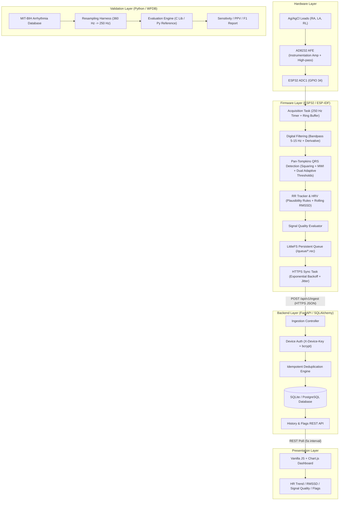

# EdgeECG — System Architecture

EdgeECG is structured as a five-tier architecture designed for continuous physiological sensing, edge digital signal processing, fault-tolerant offline persistence, and cloud synchronization.

---

## 1. End-to-End System Diagram

---

## 2. Layer Responsibilities & Data Flow

### 2.1 Hardware & Acquisition
- **Cadence**: 250 Hz (exact 4 ms period) driven by an ESP-IDF hardware timer interrupt / high-priority task on Core 1.
- **Buffering**: Lock-free or spinlock-protected ring buffer isolating real-time ISR sampling from signal processing workloads.

### 2.2 Signal Processing Pipeline
- **Bandpass Filter**: 2nd-order Butterworth bandpass (5–15 Hz) attenuates baseline wander (<0.5 Hz) and 50/60 Hz powerline interference.
- **Derivative Filter**: Enhances QRS steep slopes while suppressing P/T waves.
- **Squaring & Moving Window Integration (MWI)**: Nonlinear energy amplification over a 120 ms (30-sample) sliding window.
- **Adaptive Thresholding**: Dual running threshold estimators for signal peaks and noise peaks, with refractory lockout (200 ms) and searchback.
- **RR Interval & RMSSD**: Rolling 60-second window, calculating valid heart rates and RMSSD in milliseconds.

### 2.3 Offline Queuing & Synchronization
- **Storage**: Persistent storage in LittleFS (`/queue/<seq>.rec`).
- **Resilience**: Operates indefinitely without Wi-Fi; records survive power interruptions and device resets.
- **Transmission**: Batched HTTPS POST requests (up to 100 records per payload) with exponential backoff and jitter. Records are deleted from local storage only upon receiving verified HTTP 200 acknowledgments.

### 2.4 Ingestion & Storage API
- **Atomic Deduplication**: Composite primary/unique constraint on `(device_id, sequence)` prevents duplicate records regardless of network retries.
- **Transaction Safety**: All batch operations occur within a single database transaction, ensuring consistent acknowledgments.

### 2.5 Validation Layer
- Fully automated evaluation script using PhysioNet's MIT-BIH dataset.
- Exact one-to-one beat matching with documented window tolerances (±100 ms and ±50 ms).
