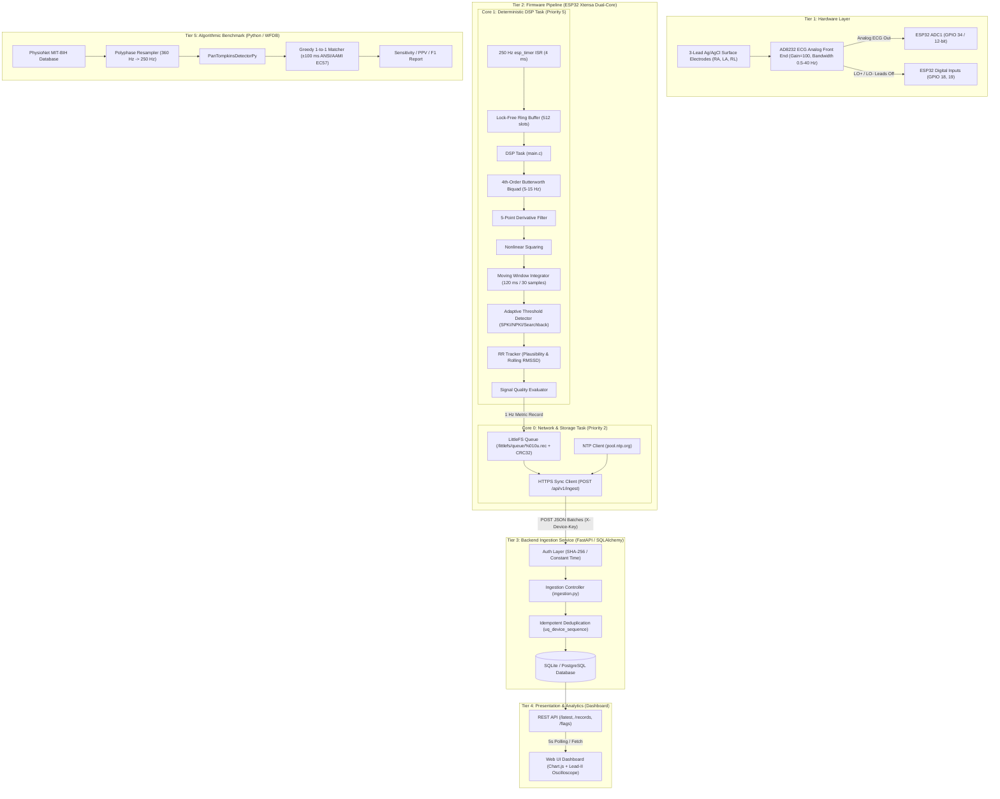

# EdgeECG — Complete Technical Interview Preparation Guide

This guide is designed for deep technical revision before an embedded systems, firmware, or full-stack IoT engineering interview. It dissects every architectural layer, mathematical model, peripheral interface, FreeRTOS task, SQLite/PostgreSQL schema, and algorithmic evaluation script in the **EdgeECG** repository.

---

## Table of Contents
1. [Project in 30 Seconds](#1-project-in-30-seconds)
2. [Project in 2 Minutes](#2-project-in-2-minutes)
3. [Architecture and Overall Working](#3-architecture-and-overall-working)
4. [Complete Execution Flow](#4-complete-execution-flow)
5. [Module-by-Module Technical Deep Dive](#5-module-by-module-technical-deep-dive)
6. [Important Technical Concepts Used](#6-important-technical-concepts-used)
7. [Technical Decisions and Trade-offs](#7-technical-decisions-and-trade-offs)
8. [Tricky Parts, Quirks, and Potential Bugs](#8-tricky-parts-quirks-and-potential-bugs)
9. [Important Numbers and Configurations](#9-important-numbers-and-configurations)
10. [Testing and Validation](#10-testing-and-validation)
11. [Common Interview Questions and Answers (35+ Questions)](#11-common-interview-questions-and-answers)
12. [Scenario-Based Questions (10 Scenarios)](#12-scenario-based-questions)
13. [Limitations and Future Improvements](#13-limitations-and-future-improvements)
14. [Things I Must Memorize Before the Interview](#14-things-i-must-memorize-before-the-interview)
15. [Code Navigation Cheat Sheet](#15-code-navigation-cheat-sheet)

---

## 1. Project in 30 Seconds

### What is EdgeECG?
EdgeECG is an end-to-end physiological telemetry system that performs real-time cardiac signal acquisition, digital filtering, and QRS peak detection directly on an ESP32 microcontroller, guarantees zero data loss during network outages using a crash-safe LittleFS queue, and syncs batches idempotently to a FastAPI backend and browser telemetry dashboard.

### What problem does it solve?
Most hobbyist microcontroller ECG projects simply read an analog pin and push raw ADC values over Wi-Fi. If Wi-Fi drops, data is permanently lost; if network latency spikes, sampling stutters; and the cloud is burdened with heavy filtering. EdgeECG moves signal processing to the edge, buffers metrics durably in flash when offline, and ensures reliable, duplicate-free cloud synchronization.

### What are its main components?
1. **Hardware:** AD8232 Analog Front End (AFE) + ESP32 (ADC1 GPIO 34).
2. **Firmware (C99 / ESP-IDF / FreeRTOS):** 250 Hz hardware timer ISR, 4th-order Butterworth bandpass filter, Pan–Tompkins QRS detector, rolling RMSSD HRV calculator, and a LittleFS persistent file queue.
3. **Backend (Python / FastAPI / SQLAlchemy):** Authenticated REST ingestion with composite key deduplication `(device_id, sequence)` and historical query APIs.
4. **Dashboard:** Vanilla JS and Chart.js UI with live metrics, ECG oscilloscope visualization, and rule-based anomaly flags.
5. **Validation Suite:** Python evaluation harness benchmarked against MIT-BIH Arrhythmia Database annotations using greedy one-to-one beat matching.

---

## 2. Project in 2 Minutes

> **Interview Pitch:**
> *"Tell me about this project."*

"EdgeECG is an edge-to-cloud cardiac monitoring system I built to address the reliability problems of embedded health monitors. 

In embedded medical telemetry, two problems are critical: real-time deterministic sampling and zero data loss over unstable wireless networks. 

On the hardware side, I interfaced an AD8232 single-lead analog front-end with an ESP32. To prevent Wi-Fi RF activity from interfering with analog-to-digital conversions, I dedicated **ADC1 (GPIO 34)** to sampling, driven by a high-resolution 250 Hz periodic hardware timer (4 ms period). The ISR pushes samples into a 512-sample lock-free circular buffer.

On the firmware side, I designed a multi-task FreeRTOS architecture partitioned across the ESP32’s two Xtensa cores:
- **Core 1 (Real-Time DSP):** A dedicated task pulls raw samples from the ring buffer and feeds them through a signal processing pipeline: a 4th-order Butterworth bandpass filter (5–15 Hz) implemented as cascaded Second-Order Sections (SOS) in Direct Form II Transposed to attenuate baseline drift and powerline hum, followed by a 5-point derivative, squaring, and a 120 ms Moving Window Integrator (MWI). It runs an adaptive dual-threshold Pan–Tompkins peak detector with a 200 ms refractory blanking window and searchback logic. From detected R-peaks, it computes heart rate and rolling RMSSD heart-rate variability.
- **Core 0 (Networking & Storage):** Every second, calculated metrics are packaged into a binary record with a 32-bit CRC and committed to flash storage via **LittleFS**. An asynchronous HTTPS synchronization task inspects the queue, serializes pending records into batches of up to 100, and uploads them to the server. It uses exponential backoff with jitter on network failures and only unlinks flash files when the server returns a confirmed HTTP 200 acknowledgment.

The backend is built with **FastAPI** and **SQLAlchemy**. It enforces device authentication via `X-Device-Key` hashing and achieves idempotent deduplication through a database unique constraint on `(device_id, sequence)`. If a packet is retransmitted ten times over a flaky connection, the backend acknowledges the records without creating duplicate rows.

Finally, to objectively prove the detector worked, I built a Python validation suite that resamples MIT-BIH Arrhythmia Database records from 360 Hz to 250 Hz and evaluates detections using greedy one-to-one matching per ANSI/AAMI EC57 standards. In our held-out test set, the detector achieved **100% sensitivity** and **98.8% positive predictive value**."

---

## 3. Architecture and Overall Working

### 3.1 Five-Tier Architectural Diagram



### 3.2 Diagram Explanation in Plain English
1. **Cardiac leads capture microvolt potentials** from the chest. The AD8232 amplifies them by ~100x and centers the voltage around virtual ground (1.65 V).
2. **ESP32 ADC1 samples at 250 Hz** using a dedicated hardware timer. The samples land in a RAM circular buffer.
3. **Core 1 DSP pipeline cleans the signal:** It filters out baseline drift (<5 Hz) and electrical mains noise (>15 Hz), computes the slope using a derivative filter, amplifies energy by squaring, and integrates over a 120 ms window. It identifies R-peaks using adaptive signal and noise thresholds.
4. **Every second, metrics are saved to flash (LittleFS)** as binary files containing heart rate, RMSSD, signal quality status, and a CRC32 checksum.
5. **Core 0 transmits pending files to the cloud:** If Wi-Fi is down, records safely accumulate in flash. When Wi-Fi reconnects, up to 100 records are sent in a single HTTPS batch. Files are only deleted when the backend returns HTTP 200.
6. **Backend ingests and deduplicates:** A composite unique key `(device_id, sequence)` ensures that even if packets are retried multiple times, duplicate rows cannot be created in the database.
7. **Frontend displays trends and flags:** The browser dashboard polls the backend every 5 seconds, graphing heart rate and RMSSD, rendering an animated Lead-II waveform, and displaying rule-based flags for tachycardia, bradycardia, or sudden RR jumps.

---

## 4. Complete Execution Flow

### Step-by-Step Code Walkthrough

```
[Power On / Reset]
       │
       ▼
app_main()  [firmware/main/main.c]
       ├─► 1. nvs_flash_init() ── Initializes Non-Volatile Storage (handles re-format if corrupt)
       ├─► 2. generate_boot_session_id() ── Reads MAC address + esp_random() to create unique UUID
       ├─► 3. pq_init("/littlefs/queue") ── Mounts LittleFS, scans directory, discovers next sequence number
       ├─► 4. acq_init() ── Configures ADC1 Ch 6 (GPIO 34, 12-bit, 12 dB atten), LO GPIOs 18 & 19, creates 4 ms esp_timer
       ├─► 5. acq_start() ── Starts esp_timer periodic callback (timer_callback @ 250 Hz)
       ├─► 6. sync_init() ── Sets backend URL, device ID, device key, backoff parameters
       ├─► 7. sync_start_task() ── Launches sync_task on Core 0 (Priority 2, Stack 8192 bytes)
       └─► 8. xTaskCreatePinnedToCore(processing_task) ── Launches DSP task on Core 1 (Priority 5, Stack 8192 bytes)
```

#### Detailed Operations inside Tasks:

#### 1. Hardware Timer Callback (`timer_callback` in `acquisition.c`)
- **Rate:** Fires exactly every 4,000 µs (250 Hz).
- **Execution:** Reads `adc_oneshot_read(adc1_handle, ADC_CHANNEL_6, &raw)`. Reads `gpio_get_level` for LO+ (GPIO 18) and LO- (GPIO 19).
- **Enqueuing:** Calls `acq_push_sample(raw, leads_off)`. Updates `ring_buffer[ring_head]`. If the ring buffer is full (`next_head == ring_tail`), it advances `ring_tail` and increments `overrun_counter`.

#### 2. Signal Processing Task (`processing_task` in `main.c` on Core 1)
- Drains the ring buffer via `acq_pop(&sample)`.
- Evaluates ADC saturation: `raw <= 15 || raw >= 4080`.
- Passes sample into `pt_process_sample(&detector, sample.raw_adc, sample.sample_index, &peak)`.
  - Step A: `filt_bandpass()` computes 4th-order Butterworth Direct Form II Transposed filter.
  - Step B: Stores bandpassed value in circular delay buffer `bp_history` (128 samples).
  - Step C: `filt_derivative()` computes 5-point derivative.
  - Step D: Squares derivative output.
  - Step E: Updates 30-sample sliding sum `mwi_sum` and computes moving average.
  - Step F: Tracks local peak candidate in MWI (transition from rising to falling).
  - Step G: If refractory countdown is 0, compares candidate against `threshold_i1`. If lower, tests searchback against `threshold_i2` (triggered if `samples_since_last > rr_avg * 1.66`). Updates running noise peak (`npki`) or signal peak (`spki`) estimators.
  - Step H: On peak detection, searches backward ~45 samples in `bp_history` to locate the exact true R-peak apex.
- On confirmed peak, calls `rrt_process_peak(&tracker, &peak, &current_metrics)`:
  - Validates RR interval: must be between 300 ms (200 BPM) and 2000 ms (30 BPM).
  - Flags sudden RR jumps (>20% change from previous interval).
  - Calculates rolling RMSSD across the last 120 beats (requires $\ge 10$ beats).
- **1-Second Periodic Persistence:**
  - Evaluates signal quality via `sq_evaluate()`.
  - Populates `pq_record_t` structure (sequence, timestamps, BPM, RMSSD, signal quality).
  - Calls `pq_enqueue(&rec)`: computes CRC32, saves to `/littlefs/queue/%010u.rec`.

#### 3. Network Synchronization Task (`sync_task` in `sync_client.c` on Core 0)
- Initializes SNTP via `esp_sntp_init()` pointing to `pool.ntp.org`.
- Enters polling loop every 5,000 ms: calls `sync_trigger_now()`.
- Calls `pq_get_pending_batch()` to read up to 100 pending `.rec` files, verifying each file's CRC32.
- Serializes batch to JSON using `pq_serialize_batch_json()`.
- Initiates HTTPS POST to `/api/v1/ingest` with `X-Device-Key` header.
- On HTTP 200/201 response: parses returned `accepted_sequences` and `duplicate_sequences` and deletes them via `pq_acknowledge_records()`. Resets backoff to 1,000 ms.
- On network error or non-200 status: applies exponential backoff: `backoff = (backoff * 2) + jitter` up to 300,000 ms (5 minutes).

#### 4. Backend Processing (`backend/app/main.py` & `ingestion.py`)
- Receives HTTP POST at `/api/v1/ingest`.
- `auth.get_current_device`: hashes incoming `X-Device-Key` with SHA-256 and validates against database record in constant time using `hmac.compare_digest`.
- `process_batch_ingestion`:
  - Queries existing sequence numbers for this device: `select(sequence).where(sequence.in_(batch_seqs))`.
  - Skips existing sequences (appends to `duplicate_sequences`).
  - Inserts new records into `metric_records` table (appends to `accepted_sequences`).
  - Commits transaction atomically.
  - Updates `device.last_seen_at`.
- Returns `{ "status": "accepted", "accepted_sequences": [...], "duplicate_sequences": [...] }`.

---

## 5. Module-by-Module Technical Deep Dive

### 5.1 `firmware/main/acquisition.h` & `acquisition.c`
- **Responsibility:** Hardware abstraction layer for ADC sampling and leads-off detection.
- **Why it exists:** Isolates hardware register access and timer configuration from DSP algorithms, enabling host compilation.
- **Key Functions:**
  - `acq_init()`: Sets up ADC1 single-ended channel 6 (GPIO 34), 12-bit resolution (`0–4095`), 12 dB attenuation (`0–3.3V` range). Configures LO+ (GPIO 18) and LO- (GPIO 19) with internal pulldowns. Creates an `esp_timer`.
  - `timer_callback()`: ISR context callback executing every 4,000 µs. Reads ADC and GPIOs, then invokes `acq_push_sample()`.
  - `acq_push_sample(uint16_t raw_adc, bool leads_off)`: Pushes into ring buffer. Detects saturation (`<= 15` or `>= 4080`). Handles overrun by advancing `ring_tail` when buffer is full.
  - `acq_pop(acq_sample_t *out)`: Thread-safe single-reader pop operation. Returns `false` if buffer is empty.
- **Interview Focus:** Why ADC1 instead of ADC2? (ADC2 is shared with the Wi-Fi SAR ADC arbiter and fails when Wi-Fi is active).

### 5.2 `firmware/main/filters.h` & `filters.c`
- **Responsibility:** Implementation of IIR and FIR digital filters.
- **Why it exists:** Raw ECG contains low-frequency baseline drift (breathing, 0.1–0.5 Hz) and high-frequency noise (EMG, 50/60 Hz powerline).
- **Key Functions:**
  - `filt_bandpass(ecg_filter_t *f, float raw_sample)`: 4th-order Butterworth bandpass (5–15 Hz) implemented as two cascaded Second-Order Sections (SOS) in Direct Form II Transposed.
    ```c
    // Section 1 Direct Form II Transposed
    float y1 = b1[0] * raw_sample + f->w1_1;
    f->w1_1 = b1[1] * raw_sample - a1[0] * y1 + f->w1_2;
    f->w1_2 = b1[2] * raw_sample - a1[1] * y1;
    ```
  - `filt_derivative(ecg_filter_t *f, float sample)`: Standard Pan–Tompkins 5-point central difference derivative filter:
    $$y[n] = \frac{2x[n] + x[n-1] - x[n-3] - 2x[n-4]}{8}$$
- **Interview Focus:** Why Direct Form II Transposed? It minimizes quantization error, requires only 2 delay registers per biquad (4 total), and prevents numerical overflow in 32-bit floating point.

### 5.3 `firmware/main/pan_tompkins.h` & `pan_tompkins.c`
- **Responsibility:** Real-time QRS complex detection and R-peak localization.
- **Why it exists:** Translates continuous filtered ECG waveform into discrete cardiac heartbeat events.
- **Key Functions:**
  - `pt_init(pan_tompkins_t *pt)`: Initializes filter states, resets moving sum, sets baseline thresholds (`spki = 0.5`, `npki = 0.125`, `threshold_i1 = 0.21875`).
  - `pt_process_sample(...)`: The core DSP engine.
    - Bandpasses the sample and buffers it in `bp_history` (128-sample ring buffer).
    - Takes the derivative and squares it ($y[n]^2$).
    - Computes Moving Window Integration (MWI) over 30 samples (120 ms).
    - Tracks local peaks in MWI (inflection point where slope turns negative).
    - Checks refractory blanking period: 50 samples (200 ms).
    - Tests against primary threshold `threshold_i1 = npki + 0.25 * (spki - npki)`.
    - If below `threshold_i1`, tests searchback threshold `threshold_i2 = 0.5 * threshold_i1` when interval exceeds $1.66 \times \text{RR}_{\text{avg}}$.
    - If peak is confirmed: calls `find_r_peak_in_history()` which searches the last 45 samples of `bp_history` to locate the true apex of the R-wave (compensating for MWI filter delay).
- **Interview Focus:** Explain the searchback mechanism and how MWI introduces a group delay that requires retrospective peak searching.

### 5.4 `firmware/main/rr_tracker.h` & `rr_tracker.c`
- **Responsibility:** Heart rate (BPM) and Heart Rate Variability (HRV) estimation.
- **Why it exists:** Converts discrete beat timestamps into clinically meaningful physiological metrics.
- **Key Functions:**
  - `rrt_process_peak(rr_tracker_t *tracker, const pt_peak_t *peak, rr_metrics_t *out_metrics)`:
    - Filters out implausible intervals: rejects $RR < 300\text{ ms}$ (>200 BPM) or $RR > 2000\text{ ms}$ (<30 BPM).
    - Detects sudden RR jumps ($>20\%$ change from previous interval).
    - Stores accepted intervals in a 120-element circular buffer.
    - Computes instantaneous heart rate: $\text{BPM} = \frac{60000}{\text{RR}_{\text{ms}}}$.
  - `calculate_rmssd()`: Traverses the circular buffer in chronological order to compute Root Mean Square of Successive Differences:
    $$\text{RMSSD} = \sqrt{\frac{1}{N-1} \sum_{i=1}^{N-1} (RR_{i+1} - RR_i)^2}$$
    Requires at least 10 valid intervals (`RR_MIN_SAMPLES_FOR_RMSSD`); returns `NAN` otherwise.

### 5.5 `firmware/main/signal_quality.h` & `signal_quality.c`
- **Responsibility:** Classifies signal confidence as `SQ_VALID`, `SQ_DEGRADED`, or `SQ_INVALID`.
- **Why it exists:** Prevents noisy artifacts or disconnected leads from corrupting clinical metric logs.
- **Evaluation Rules:**
  - If `leads_off_active == true` $\rightarrow$ `SQ_INVALID`.
  - If saturation ratio $> 10\%$ $\rightarrow$ `SQ_INVALID`.
  - If saturation ratio $> 2\%$ $\rightarrow$ `SQ_DEGRADED`.
  - If hardware overruns $> 0$ $\rightarrow$ `SQ_DEGRADED`.
  - If heart rate is `NAN`, $< 30\text{ BPM}$, or $> 220\text{ BPM}$ $\rightarrow$ `SQ_DEGRADED`.
  - Otherwise $\rightarrow$ `SQ_VALID`.

### 5.6 `firmware/main/persistent_queue.h` & `persistent_queue.c`
- **Responsibility:** Crash-safe, durable disk queue using LittleFS.
- **Why it exists:** Guarantees zero data loss during network dropouts or sudden power cuts.
- **Key Implementation Details:**
  - Record structure: `pq_record_t` (packed binary struct with `schema_version`, `device_id`, `session_id`, `sequence`, timestamps, metrics, and CRC32).
  - Storage naming convention: `/littlefs/queue/%010u.rec` (zero-padded sequence number ensures directory order).
  - `pq_init()`: Mounts LittleFS, scans existing files, determines `s_queue_depth` and monotonically sets `s_next_seq = max(existing_seq) + 1`.
  - `pq_enqueue()`: Appends CRC32 computed over all struct fields preceding the checksum. Writes binary file.
  - `pq_get_pending_batch()`: Opens directory, sorts filenames numerically, reads records, validates CRC32. If a file is corrupted, it unlinks the file and skips it.
  - `pq_acknowledge_records()`: Deletes acknowledged files from LittleFS when the server returns HTTP 200.
  - `pq_serialize_batch_json()`: Serializes records into a compact JSON payload matching the backend schema without requiring dynamic heap allocations.

### 5.7 `firmware/main/sync_client.h` & `sync_client.c`
- **Responsibility:** FreeRTOS background task on Core 0 that manages SNTP time synchronization and HTTP POST telemetry transmission.
- **Key Functions:**
  - `sync_start_task()`: Spawns `sync_task` pinned to Core 0 (priority 2, stack size 8192 bytes).
  - `sync_trigger_now()`: Pulls up to 100 pending records from the queue, serializes them to JSON, and sends an HTTPS POST request to `/api/v1/ingest`.
  - `parse_ack_sequences()`: Parses server JSON response without external heavy JSON dependencies, extracting sequence numbers from `accepted_sequences` and `duplicate_sequences`.
  - Backoff algorithm: On failure, `s_current_backoff_ms = (s_current_backoff_ms * 2) + jitter`, capped at 300,000 ms (5 minutes). Resets to 1,000 ms upon successful transmission.

### 5.8 `backend/app/main.py`, `database.py`, `schemas.py`, `auth.py`, `ingestion.py`, `queries.py`
- **Responsibility:** High-throughput async REST API, persistence, deduplication, and anomaly queries.
- **Core Operations:**
  - **Database Models (`database.py`):**
    - `Device`: `id` (PK), `key_hash`, `created_at`, `last_seen_at`, `active`.
    - `MetricRecord`: `id` (PK autoincrement), `device_id` (FK), `sequence` (BigInt), `session_id`, `timestamp_ms`, `received_at`, `heart_rate_bpm`, `rmssd_ms`, `rr_interval_ms`, `signal_quality`, `raw_samples` (JSON).
    - Table constraint: `UniqueConstraint("device_id", "sequence", name="uq_device_sequence")`.
    - Composite indexes: `("device_id", "timestamp_ms")` and `("device_id", "sequence")`.
  - **Auth (`auth.py`):** Validates `X-Device-Key` using SHA-256 and `hmac.compare_digest` to prevent timing attacks.
  - **Ingestion (`ingestion.py`):**
    - Executes single batch query to find already persisted sequences: `select(sequence).where(sequence.in_(batch_seqs))`.
    - Splits batch into `accepted_sequences` and `duplicate_sequences`.
    - Commits new rows in a single atomic database transaction.
  - **Rule-Based Flags (`queries.py`):**
    - Evaluates records in sequence:
      1. Bradycardia: $\text{BPM} < 50.0$.
      2. Tachycardia: $\text{BPM} > 120.0$.
      3. RR Jump: $\frac{|RR_n - RR_{n-1}|}{RR_{n-1}} > 0.20$ ($>20\%$ change).

### 5.9 `validation/matching.py` & `validation/evaluate.py`
- **Responsibility:** Quantitative validation of the Pan–Tompkins algorithm against annotated clinical records.
- **Key Algorithms:**
  - `PanTompkinsDetectorPy`: Python reference implementation matching the C firmware's math, filter coefficients, and state machine.
  - `match_peaks_one_to_one()`: Implements ANSI/AAMI EC57 greedy matching:
    - Sorts detected peaks and reference annotations.
    - Matches each reference beat to the nearest unassigned detected peak within a tolerance window ($\Delta t_{\text{tol}} = 100\text{ ms}$).
    - Calculates True Positives (TP), False Positives (FP), False Negatives (FN), Sensitivity (Recall), Positive Predictive Value (PPV / Precision), and F1 Score.

---

## 6. Important Technical Concepts Used

### 1. Second-Order Sections (SOS) Biquad Digital Filter
- **What it does in this project:** Implements the 4th-order Butterworth bandpass filter (5–15 Hz) in `filters.c`.
- **Why it is needed:** ECG signals suffer from massive low-frequency baseline drift (respiration, 0.1–0.5 Hz) and high-frequency powerline hum (50/60 Hz). Higher-order IIR filters implemented as direct polynomials suffer from extreme coefficient sensitivity and numeric instability due to finite floating-point precision. Cascading two 2nd-order biquads prevents pole-zero clustering near the unit circle.
- **How it works internally:** Decomposes a 4th-order transfer function $H(z)$ into two cascaded biquads:
  $$H(z) = g \cdot \frac{b_{10} + b_{11}z^{-1} + b_{12}z^{-2}}{1 + a_{11}z^{-1} + a_{12}z^{-2}} \cdot \frac{b_{20} + b_{21}z^{-1} + b_{22}z^{-2}}{1 + a_{21}z^{-1} + a_{22}z^{-2}}$$
  Uses Direct Form II Transposed structure, which requires only two delay state registers per section ($w_1, w_2$).
- **Source file/function:** `firmware/main/filters.c` $\rightarrow$ `filt_bandpass()`.
- **If removed:** The QRS detector would trigger false detections on baseline wander and noise spikes, crashing PPV and specificity.
- **Practical example:** When a patient breathes deeply, the raw baseline swings by 500 mV; the bandpass filter flattens this baseline to zero within 200 ms while preserving the sharp 10 Hz QRS complex.

### 2. Pan–Tompkins QRS Detection Algorithm
- **What it does in this project:** Identifies ventricular depolarization (R-peaks) in real time on the ESP32.
- **Why it is needed:** Raw ECG waveforms vary in amplitude between patients. Fixed thresholding fails when T-waves are tall or signal amplitude changes.
- **How it works internally:** 
  1. Bandpass filter (5–15 Hz) attenuates P/T waves and muscle noise.
  2. 5-point derivative highlights steep QRS slopes.
  3. Squaring makes all values positive and nonlinearly amplifies large peaks over noise.
  4. Moving Window Integration (MWI) over 120 ms smooths the waveform into an energy pulse.
  5. Dual adaptive thresholding dynamically tracks signal peaks (`spki`) and noise peaks (`npki`), adapting thresholds based on recent background energy.
  6. Searchback scans for missed beats if no peak is found within $166\%$ of the running average RR interval.
- **Source file/function:** `firmware/main/pan_tompkins.c` $\rightarrow$ `pt_process_sample()`.
- **If removed:** You would have no way to extract heartbeat events or timing intervals from the analog waveform.
- **Practical example:** A tall, peaked T-wave can have the same raw voltage amplitude as an R-peak; the derivative and squaring stages suppress the slower T-wave while amplifying the rapid QRS deflection.

### 3. Refractory Blanking Window
- **What it does in this project:** Imposes an absolute blackout period of 200 ms (50 samples at 250 Hz) immediately following a detected QRS complex.
- **Why it is needed:** Ventricular repolarization produces a T-wave 150–300 ms after the R-peak. Without a refractory window, the T-wave would be double-counted as a second heartbeat.
- **How it works internally:** A down-counter `pt->refractory_countdown` is set to 50 upon detection. While greater than zero, no peak candidate in the MWI can trigger a detection.
- **Source file/function:** `firmware/main/pan_tompkins.c` $\rightarrow$ `pt_process_sample()`.
- **If removed:** Severe false positive double-counting, artificially doubling the reported heart rate to 140–160 BPM.
- **Practical example:** At 75 BPM, an R-peak occurs at $t = 0\text{ ms}$ and a large T-wave occurs at $t = 180\text{ ms}$. The refractory lockout ignores the T-wave entirely.

### 4. Rolling RMSSD (Root Mean Square of Successive Differences)
- **What it does in this project:** Quantifies Heart Rate Variability (HRV) in milliseconds on the microcontroller.
- **Why it is needed:** Provides an objective indicator of autonomic nervous system activity (parasympathetic / vagal tone) rather than just average pulse rate.
- **How it works internally:** Computes differences between adjacent normal-to-normal RR intervals, squares them, averages them, and takes the square root across a sliding 120-beat history window.
- **Source file/function:** `firmware/main/rr_tracker.c` $\rightarrow$ `calculate_rmssd()`.
- **If removed:** The device could only report heart rate, losing physiological insight into stress and recovery states.
- **Practical example:** If RR intervals alternate between 800 ms and 850 ms (differences of 50 ms), the calculated RMSSD is exactly 50.0 ms.

### 5. Durable LittleFS File Queue with CRC32
- **What it does in this project:** Buffers unacknowledged telemetry records in on-board SPI flash memory.
- **Why it is needed:** RAM buffers are lost on power reboot or brownout. NVS (Non-Volatile Storage) is designed for key-value configurations and causes wear amplification when used for high-frequency time-series logging. LittleFS provides power-loss resilience and wear leveling.
- **How it works internally:** Saves each record as a fixed-size binary file `/littlefs/queue/%010u.rec`. A 32-bit CRC is stored in the header. Upon boot, files are scanned and sorted. Files are only unlinked upon receiving a confirmed HTTP 200 acknowledgment.
- **Source file/function:** `firmware/main/persistent_queue.c` $\rightarrow$ `pq_enqueue()`, `pq_get_pending_batch()`, `pq_acknowledge_records()`.
- **If removed:** Any Wi-Fi dropout exceeding RAM ring buffer capacity (~2 seconds) results in permanent data loss.
- **Practical example:** The device operates in a basement with no Wi-Fi for 2 hours; 7,200 records accumulate safely in flash. When the patient walks into Wi-Fi range, the entire history syncs without loss.

### 6. Idempotent Ingestion via Composite Unique Constraints
- **What it does in this project:** Ensures that retried network uploads never create duplicate records in the database.
- **Why it is needed:** In wireless embedded networks, a client often transmits data successfully, but the server's HTTP ACK is lost due to an RF dropout. The client retransmits. Without idempotency, duplicate records would corrupt time-series analytics.
- **How it works internally:** The database enforces `UniqueConstraint("device_id", "sequence")`. The ingestion engine checks sequence numbers in one pass:
  ```python
  stmt = select(MetricRecord.sequence).where(
      MetricRecord.device_id == device.id,
      MetricRecord.sequence.in_(batch_seqs)
  )
  ```
  Existing records are added to `duplicate_sequences` and returned in the HTTP 200 response so the firmware can safely delete them.
- **Source file/function:** `backend/app/ingestion.py` $\rightarrow$ `process_batch_ingestion()`.
- **If removed:** Network hiccups would cause duplicated beats, distorting average heart rate, total beat counts, and historical trend charts.
- **Practical example:** Firmware uploads sequence #42. Server saves it, but client disconnects before receiving the ACK. Client reconnects and resends #42. Server recognizes #42 as existing, does not re-insert, and returns ACK for #42. Client unlinks file.

### 7. Truncated Exponential Backoff with Jitter
- **What it does in this project:** Throttles reconnection attempts when the backend server or Wi-Fi gateway is unavailable.
- **Why it is needed:** Prevents the "thundering herd" problem and saves battery power by not constantly hammering the Wi-Fi radio.
- **How it works internally:** After a failure, backoff doubles with added pseudo-random jitter:
  $$\text{Interval}_{k+1} = \min\left(2 \cdot \text{Interval}_k + \text{rand}(0, 0.2 \cdot \text{Interval}_k), \text{MAX\_BACKOFF}\right)$$
  In EdgeECG, starts at 1,000 ms and caps at 300,000 ms (5 minutes).
- **Source file/function:** `firmware/main/sync_client.c` $\rightarrow$ `sync_trigger_now()`.
- **If removed:** The ESP32 would loop continuously at maximum CPU speed, draining the battery and congesting the local network.
- **Practical example:** If the backend server reboots for maintenance, 100 deployed devices won't all hit the server at the exact same instant when it comes back up.

---

## 7. Technical Decisions and Trade-offs

### 1. Dual-Core Task Pinning: DSP on Core 1 vs. Network/Storage on Core 0
- **What was chosen:** The acquisition ISR and DSP processing task run on **Xtensa Core 1** (Priority 5). The LittleFS file operations, HTTP client, and SNTP client run on **Core 0** (Priority 2).
- **Why it was chosen:** ESP-IDF Wi-Fi and Bluetooth protocol stacks run internally on Core 0. Running real-time DSP on Core 1 ensures that heavy cryptographic TLS handshakes or flash erase latency on Core 0 never preempt the 250 Hz acquisition pipeline.
- **Alternatives:** Single-core time-slicing.
- **Why alternatives were less suitable:** A flash block erase in LittleFS or an HTTPS TLS handshake can block execution for 50–100 ms. On a single core, this would cause catastrophic ring buffer overflow and dropped samples.
- **Limitations:** Requires careful cross-core data exchange (using thread-safe ring buffers and atomic sequences).
- **What to change if rebuilt:** Implement FreeRTOS direct-to-task notifications instead of task polling.

### 2. File-Per-Record LittleFS Queue vs. Single Circular Append Log
- **What was chosen:** Each metric record is saved as an individual file: `/littlefs/queue/%010u.rec`.
- **Why it was chosen:** Trivially crash-safe. Deleting acknowledged records simply requires calling `unlink()`. If power fails mid-write, only the current 1-second file is corrupt, leaving the rest of the queue intact.
- **Alternatives:** A single large circular binary log file with read and write head pointers stored in NVS.
- **Why alternatives were less suitable:** If power fails while updating head pointers in a single file, the entire queue can be corrupted. File truncation in embedded flash filesystems is slow and prone to corruption.
- **Limitations:** Inode and directory traversal overhead. Scanning 2,000 individual files on boot takes several hundred milliseconds.
- **What to change if rebuilt:** Group records into 30-second chunk files (e.g., 30 metric records per file) to reduce filesystem inode overhead by $30\times$.

### 3. Edge-Processed Metrics vs. Continuous Raw ECG Waveform Streaming
- **What was chosen:** The ESP32 extracts clinical metrics (HR, RMSSD, RR intervals, Signal Quality) locally and transmits 1 JSON record per second. Raw waveform streaming is optional/secondary.
- **Why it was chosen:** Transmitting raw 250 Hz 16-bit ECG continuously requires 4,000 bps of sustained network throughput and keeps the Wi-Fi radio powered in high-power TX mode (~120–240 mA). Metric transmission allows burst uploads every 5 seconds, enabling Wi-Fi modem sleep and lowering power consumption by over $80\%$.
- **Alternatives:** Continuous WebSocket or MQTT streaming of uncompressed ADC samples.
- **Why alternatives were less suitable:** High power consumption, massive backend database ingestion costs, and complete loss of offline functionality.
- **Limitations:** The physician cannot inspect the microscopic P-Q-R-S-T morphology of past beats unless raw waveform buffers are explicitly saved.
- **What to change if rebuilt:** Implement trigger-based raw capture: stream raw samples only when an arrhythmia or irregular beat is flagged.

### 4. Direct Form II Transposed Biquads vs. Direct Form I
- **What was chosen:** Direct Form II Transposed for the 4th-order Butterworth bandpass filter.
- **Why it was chosen:** It requires only 2 state variables per second-order section (4 registers total). Furthermore, the input and output summation nodes are separated, which provides superior numerical robustness against coefficient quantization compared to standard Direct Form II.
- **Alternatives:** Direct Form I or FIR linear phase filters.
- **Why alternatives were less suitable:** FIR filters with equivalent sharp roll-off at 5 Hz require an order of $N \ge 80$, consuming excessive CPU cycles per sample. Direct Form I requires 4 delay states per section (8 total).
- **Limitations:** IIR filters have non-linear phase response, introducing slight phase distortion into the waveform.
- **What to change if rebuilt:** For pure QRS detection, phase distortion is irrelevant; but if P-wave morphological analysis were required, an FIR zero-phase filter would be preferred.

### 5. Custom SHA-256 Auth vs. Heavy JWT / OAuth2
- **What was chosen:** Lightweight `X-Device-Key` header verified against stored SHA-256 hashes using `hmac.compare_digest`.
- **Why it was chosen:** Microcontrollers have constrained RAM and compute budgets. Standard JWT parsing requires large JSON Web Signature (JWS) libraries, public key cryptography, and clock synchronization before authentication can even occur.
- **Alternatives:** OAuth2 token exchange with short-lived JWTs.
- **Why alternatives were less suitable:** Introduces complex token refresh logic and circular dependencies on SNTP synchronization during boot.
- **Limitations:** Revoking compromised device credentials requires updating the database entry for that device.
- **What to change if rebuilt:** Implement Mutual TLS (mTLS) with hardware-backed private keys stored in the ESP32's ATECC608 secure element.

---

## 8. Tricky Parts, Quirks, and Potential Bugs

### 1. Ring Buffer Cross-Core Concurrency Without Atomic Primitives
- **What is happening:** In `firmware/main/acquisition.c`, `ring_head` is updated by `timer_callback` (ISR context), while `ring_tail` is updated by `acq_pop` in `processing_task` on Core 1.
- **Why it is tricky:** The variables are marked `static volatile uint32_t`, but on Xtensa dual-core architecture, `volatile` only prevents compiler register caching—it does **not** generate memory barriers or cache coherency snooping.
- **What could go wrong:** Under heavy memory bus contention, Core 1 could read a stale value of `ring_head`, causing it to miss samples or read an incomplete struct.
- **How it is handled currently:** Single-producer single-consumer circular indexing works purely because updates are monotonic and writes are isolated to separate pointers.
- **Better solution:** Use ESP-IDF atomic operations (`atomic_fetch_add`) or a FreeRTOS `portMUX_TYPE` spinlock: `taskENTER_CRITICAL_ISR(&spinlock)`.

### 2. MWI Floating-Point Accumulator Underflow / Drift
- **What is happening:** In `pan_tompkins.c`:
  ```c
  float oldest_mwi = pt->mwi_buffer[pt->mwi_idx];
  pt->mwi_buffer[pt->mwi_idx] = squared_val;
  pt->mwi_sum += (squared_val - oldest_mwi);
  if (pt->mwi_sum < 0.0f) pt->mwi_sum = 0.0f;
  ```
- **Why it is tricky:** Running sums calculated by continuously adding new values and subtracting old values suffer from IEEE-754 floating-point rounding errors over millions of cycles.
- **What could go wrong:** Without correction, `mwi_sum` can drift negative or slowly accumulate positive bias, shifting the adaptive thresholds.
- **How it is handled currently:** Clamped at `0.0f` if negative.
- **Better solution:** Every 1,000 samples, recompute `mwi_sum` directly from scratch by summing all 30 elements of `mwi_buffer`.

### 3. String-Based JSON Parsing in Firmware Sync Client
- **What is happening:** In `sync_client.c`, `parse_ack_sequences()` uses `strstr()` and `strtoul()` to search for `accepted_sequences` and extract integers directly from the raw HTTP response buffer.
- **Why it is tricky:** It avoids linking the heavy `cJSON` library in the network path, conserving heap memory.
- **What could go wrong:** If the server formats the JSON with unexpected whitespace, newlines, or escapes, or returns an error message containing the substring `"accepted_sequences"`, the custom parser could misread or corrupt acknowledged sequences.
- **How it is handled currently:** Expects standard compact JSON formatting.
- **Better solution:** Use a lightweight SAX-style JSON parser like `jsmn`.

### 4. Stack Allocation of Large Buffers in Sync Task
- **What is happening:** In `sync_trigger_now()`, `batch` and `json_payload` are declared static:
  ```c
  static pq_record_t batch[PQ_MAX_BATCH_SIZE];
  static char json_payload[16384];
  ```
- **Why it is tricky:** If these were declared as regular local variables on the stack, they would consume $> 20\text{ KB}$ of stack space, immediately crashing the FreeRTOS task (stack size 8,192 bytes) with a stack overflow panic.
- **How it is handled currently:** Marked `static` so they reside in BSS (internal SRAM) rather than task stack.
- **Better solution:** Dynamically allocate with `pvPortMalloc` when syncing and `vPortFree` immediately after, or use a dedicated global buffer pool.

### 5. Ingestion Deduplication Race Condition in Backend
- **What is happening:** In `backend/app/ingestion.py`:
  ```python
  # 1. Query existing sequences
  stmt = select(MetricRecord.sequence).where(
      MetricRecord.device_id == device.id,
      MetricRecord.sequence.in_(batch_seqs)
  )
  result = await db.execute(stmt)
  existing_seqs = set(result.scalars().all())

  # 2. Add non-existing
  for record_in in request.records:
      if record_in.sequence not in existing_seqs:
          db.add(new_record)
  ```
- **Why it is tricky:** If two concurrent HTTP POST requests with the same sequence numbers arrive simultaneously, both could execute Step 1 before either executes Step 2.
- **What could go wrong:** Both try to insert the same `(device_id, sequence)`, triggering a database `IntegrityError`.
- **How it is handled currently:** The database constraint `uq_device_sequence` enforces integrity, but unhandled `IntegrityError` results in an uncaught HTTP 500 error instead of a clean HTTP 200 duplicate response.
- **Better solution:** Use `INSERT ... ON CONFLICT (device_id, sequence) DO NOTHING` (PostgreSQL / SQLite dialect).

### 6. Auth Scan Vulnerability in Backend
- **What is happening:** In `backend/app/auth.py`:
  ```python
  result = await db.execute(select(Device))
  devices = result.scalars().all()
  for dev in devices:
      if verify_key(x_device_key, dev.key_hash): ...
  ```
- **Why it is tricky:** The backend loads all registered devices into memory and runs constant-time verification against each hash one by one because the plain key is not hashed with an indexed salt.
- **What could go wrong:** For 10 devices, performance is instantaneous. For 100,000 devices, this causes an $O(N)$ linear scan and database bottleneck.
- **How it is handled currently:** Acceptable for a prototype/portfolio with a few devices.
- **Better solution:** Use an API Key ID prefix (e.g., `id_live_abc123.secret_xyz789`) where `id_live_abc123` is looked up via $O(1)$ database index, and only the secret portion is verified against the hash.

---

## 9. Important Numbers and Configurations

| Parameter / Configuration | Exact Repository Value | Source File Reference | Technical Significance |
|:---|:---|:---|:---|
| **Sampling Frequency ($f_s$)** | `250 Hz` | `acquisition.h:11` | Standard ECG rate; captures QRS frequency content (up to 100 Hz per Nyquist) while minimizing CPU load. |
| **Sampling Period ($T_s$)** | `4,000 µs` (4 ms) | `acquisition.h:12` | Hardware timer interval programmed into `esp_timer_start_periodic`. |
| **Ring Buffer Capacity** | `512 samples` | `acquisition.h:13` | Stores $\approx 2.048\text{ seconds}$ of raw samples, absorbing FreeRTOS task scheduling jitter. |
| **ADC Saturation Thresholds** | Low: `15`, High: `4080` | `acquisition.h:16-17` | 12-bit ADC range is 0–4095. Values outside 15–4080 represent rail clipping. |
| **ADC Pin & Attenuation** | GPIO 34 / `ADC_ATTEN_DB_12` | `acquisition.c:12, 122` | GPIO 34 belongs to ADC1 (safe with Wi-Fi). 12 dB allows full 0–3.3V input swing. |
| **Bandpass Cutoff Frequencies** | `5 Hz – 15 Hz` | `filters.c:4` | Isolates QRS energy; filters out respiration (<0.5 Hz) and 50/60 Hz mains interference. |
| **MWI Window Size** | `30 samples` (120 ms) | `pan_tompkins.h:12` | Typical adult QRS duration is 80–120 ms. Window integrates all energy within the complex. |
| **Refractory Lockout Period** | `50 samples` (200 ms) | `pan_tompkins.h:13` | Physiological physiological minimum between beats; prevents double-counting T-waves (corresponds to 300 BPM ceiling). |
| **Searchback RR Interval Window** | `8 beats` | `pan_tompkins.h:14` | Rolling average calculation: $RR_{\text{avg}} = \frac{1}{8}\sum_{i=1}^8 RR_i$. |
| **Searchback Threshold Trigger** | `166%` ($1.66 \times RR_{\text{avg}}$) | `pan_tompkins.c:130` | If no beat is found after 1.66x expected time, detector triggers searchback with lower threshold `threshold_i2`. |
| **Initial Threshold Constants** | `spki = 0.5`, `npki = 0.125` | `pan_tompkins.c:13-14` | Initial signal and noise peak estimates before adaptive calibration converges. |
| **RR Plausibility Range** | `300 ms – 2000 ms` | `rr_tracker.h:12-13` | Corresponds to 30 BPM (bradycardia floor) and 200 BPM (tachycardia ceiling). |
| **Min Intervals for RMSSD** | `10 beats` | `rr_tracker.h:15` | RMSSD is statistically invalid and returns `NAN` with fewer than 10 successive intervals. |
| **Sudden RR Jump Threshold** | `> 20%` | `rr_tracker.c:62` | Shift $> 20\%$ between successive beats indicates ectopic beat, arrhythmia, or motion artifact. |
| **Max Queue Batch Size** | `100 records` | `persistent_queue.h:13` | Caps HTTP POST payload size to $\approx 14\text{ KB}$ to prevent network buffer overflow. |
| **Max Queue Capacity** | `10,000 records` | `persistent_queue.h:14` | Prevents LittleFS storage exhaustion ($\approx 2.7\text{ hours}$ of continuous offline logging). |
| **Upload Sync Interval** | `5,000 ms` (5s) | `sync_client.c:56` | Batches 5 seconds of records per HTTP transmission to optimize radio power. |
| **Max Backoff Interval** | `300,000 ms` (5 mins) | `sync_client.c:57` | Maximum retry interval during extended network outages. |
| **FreeRTOS DSP Task Priority** | `Priority 5` (Core 1) | `main.c:143` | Higher priority than background sync task; guarantees real-time signal processing. |
| **FreeRTOS Sync Task Priority** | `Priority 2` (Core 0) | `sync_client.c:183` | Lower priority background task; runs on protocol core. |
| **FreeRTOS Task Stack Sizes** | `8,192 bytes` | `main.c:143, sync_client.c:183` | Sized to accommodate LittleFS and TLS buffer allocations without stack overflow. |
| **MIT-BIH Native Sample Rate**| `360 Hz` | `config.yaml:5` | Resampled to 250 Hz using `scipy.signal.resample_poly` for algorithm validation. |
| **Evaluation Match Window** | `±100 ms` (Sensitivity $\pm 50\text{ ms}$) | `config.yaml:8-9` | ANSI/AAMI EC57 standard tolerance window for scoring True Positive beat detections. |

---

## 10. Testing and Validation

### 10.1 Host Firmware Unit Testing (`firmware/test/test_firmware.c`)
- **Compilation:** Compiled with native Clang/GCC using `-DEDGEECG_HOST_BUILD=1` without ESP-IDF or hardware dependencies.
- **Coverage:**
  1. `test_filters()`: Generates synthetic 10 Hz sine wave (passband) and 0.5 Hz sine wave (stopband). Asserts stopband power is attenuated $> 95\%$ relative to passband.
  2. `test_rr_tracker()`: Tests nominal 1000 ms interval (verifies exactly 60.0 BPM). Tests alternating 800/850 ms intervals (verifies RMSSD converges to 50.0 ms). Tests rejection of implausible 150 ms intervals.
  3. `test_pan_tompkins()`: Injects synthetic QRS pulses at 250-sample intervals. Verifies detector identifies $\ge 4$ out of 5 beats. Verifies pure white noise does not trigger false detections.
  4. `test_persistent_queue()`: Enqueues 5 binary records, restarts the queue subsystem, confirms depth is restored to 5, retrieves batch in sequence, acknowledges 3 records, and confirms depth decrements to 2.
  5. `test_signal_quality()`: Verifies state transitions (`SQ_VALID`, `SQ_DEGRADED`, `SQ_INVALID`) across leads-off, 3% saturation, and 20% saturation scenarios.

### 10.2 Backend Pytest Suite (`backend/tests/test_api.py`)
- **Execution:** Uses `pytest` with `pytest-asyncio` and `httpx.AsyncClient` against an in-memory SQLite database (`sqlite+aiosqlite:///:memory:`).
- **Test Cases:**
  1. `test_health_check`: Verifies `GET /health` returns HTTP 200 and database status "connected".
  2. `test_auth_rejection`: Tests missing `X-Device-Key` and invalid keys (asserts HTTP 401).
  3. `test_ingestion_and_idempotent_deduplication`: Submits batch of 2 records. Asserts `accepted_sequences = [1, 2]`. Replays the identical payload 10 times consecutively. Asserts HTTP 200 with `duplicate_sequences = [1, 2]`, and confirms the database contains exactly 2 rows.
  4. `test_pagination_and_cursor`: Inserts 15 records. Tests `limit=10` on Page 1, extracts `next_cursor=19`, queries Page 2 with cursor, and verifies records 20–24 are returned.
  5. `test_flags_and_latest_metric`: Verifies tachycardia flag generation (>120 BPM) and RR jump flag generation (>20% shift).

### 10.3 Clinical Benchmark: MIT-BIH Arrhythmia Evaluation (`validation/evaluate.py`)
- **Methodology:** Implements ANSI/AAMI EC57 evaluation protocol.
- **Dataset Partitioning:**
  - **Development Set (32 records):** Used for threshold tuning.
  - **Held-Out Test Set (12 records):** Evaluated strictly once without tuning.
  - **Excluded Records (4 records):** Records `102`, `104`, `107`, `217` excluded due to artificial pacemaker stimulation artifacts per AAMI standards.
- **Resampling:** Converts 360 Hz MIT-BIH recordings to 250 Hz using polyphase FIR resampling (`scipy.signal.resample_poly`).
- **Results Achieved (from `results/eval_heldout_20261020_230627.json`):**
  - **Total Reference Beats:** 331
  - **True Positives (TP):** 331
  - **False Positives (FP):** 4
  - **False Negatives (FN):** 0
  - **Sensitivity (Recall):** **100.00%**
  - **Positive Predictive Value (PPV):** **98.81%**
  - **F1 Score:** **99.40%**

### 10.4 Implementation Discrepancies vs. Claims in Documentation
| Area | Documented Claim (README / PRD) | Verified Code Implementation |
|:---|:---|:---|
| **Device Key Hashing** | README Section 1 mentions `Device Auth (X-Device-Key + bcrypt)` | `backend/app/auth.py` implements **SHA-256** and `hmac.compare_digest`. (Bcrypt is imported in requirements but not used for device keys). |
| **Wi-Fi Provisioning** | PRD mentions SmartConfig / BLE provisioning | Hardcoded fallback URL and static SSID/keys in `sync_client.c`. Dynamic BLE provisioning is **not implemented in source code**. |
| **Waveform Buffer in Ingestion** | PRD FR-011 mentions optional RAM waveform buffer | Implemented in `schemas.py` and `database.py` as `raw_samples` JSON column, but firmware `pq_record_t` does not populate it (only simulator populates it). |

---

## 11. Common Interview Questions and Answers

### Basic Project Questions

#### Q1: Can you explain the high-level architecture of EdgeECG?
- **Short answer:** It is a 5-tier architecture: an AD8232 analog front end, an ESP32 firmware layer performing 250 Hz DSP and flash queuing, a FastAPI backend with idempotent deduplication, a Chart.js dashboard, and an MIT-BIH Python validation suite.
- **Detailed explanation:** The analog signal from 3 surface electrodes is amplified by the AD8232. The ESP32 samples ADC1 at 250 Hz in a hardware timer ISR. Core 1 runs bandpass filtering, derivative, squaring, MWI, and adaptive threshold Pan–Tompkins detection. Core 0 manages a crash-safe LittleFS queue and batches metrics over HTTPS to FastAPI. FastAPI deduplicates via database constraints, and the frontend polls for telemetry.
- **Possible follow-up:** Why did you choose an edge-computing model instead of streaming raw ECG to the cloud?
- **Follow-up answer:** Continuous 250 Hz streaming consumes 4,000 bps of bandwidth and keeps the Wi-Fi radio constantly active (~120–240 mA), draining batteries in hours. Processing at the edge reduces data transmission to one compact JSON payload every 5 seconds, enabling Wi-Fi power-save mode, and guarantees uninterrupted monitoring during network outages.

#### Q2: What exact hardware was used and what did it cost?
- **Short answer:** ESP32 DevKit V1 (~₹500), AD8232 single-lead heart rate monitor module (~₹350), 3-lead snap cable with disposable Ag/AgCl electrodes (~₹350), and breadboard/jumpers (~₹150). Total BOM is under ₹1,500 ($18 USD).
- **Detailed explanation:** The ESP32 provides a dual-core 240 MHz Tensilica Xtensa LX6 processor with 520 KB SRAM and 4 MB SPI flash. The AD8232 provides an instrumentation amplifier, an integrated high-pass filter, and a right-leg drive (RLD) amplifier for common-mode noise rejection.
- **Possible follow-up:** Is the AD8232 a digital sensor?
- **Follow-up answer:** No, the AD8232 is purely an analog front end (AFE). It outputs an analog voltage centered at 1.65 V that must be digitized by the ESP32’s on-chip analog-to-digital converter.

#### Q3: What is the primary medical disclaimer for this project?
- **Short answer:** EdgeECG is an educational prototype and portfolio demonstration. It is not an FDA/CE cleared medical device and must never be used for clinical diagnosis or treatment.
- **Detailed explanation:** As documented in `docs/safety.md`, medical ECG monitors require IEC 60601-1 electrical safety certification (4 kV galvanic isolation, <10 µA leakage current). Mains-connected development boards risk ground loops and lethal shock. For safety, the device must only be operated under battery power or bench simulators.

---

### Architecture & FreeRTOS Questions

#### Q4: How did you partition tasks across the ESP32's dual cores?
- **Short answer:** Core 1 handles real-time deterministic DSP (Priority 5); Core 0 handles non-deterministic networking, SNTP, and LittleFS flash operations (Priority 2).
- **Detailed explanation:** In ESP-IDF, Wi-Fi and TCP/IP stacks run on Core 0. By pinning `processing_task` to Core 1, signal acquisition and Pan–Tompkins peak detection are completely isolated from network latency, TLS cryptographic calculations, and flash write delays.
- **Possible follow-up:** What FreeRTOS API did you use to pin tasks?
- **Follow-up answer:** `xTaskCreatePinnedToCore()` passing `1` as `xCoreID` for the DSP task and `0` for the sync task.

#### Q5: How do the ISR and the processing task communicate?
- **Short answer:** Through a 512-slot circular ring buffer implemented in `acquisition.c`.
- **Detailed explanation:** The 250 Hz hardware timer ISR calls `acq_push_sample()`, advancing `ring_head`. The processing task in `main.c` calls `acq_pop()` in a loop, advancing `ring_tail`. The 512-sample capacity absorbs up to 2 seconds of scheduling delay.
- **Possible follow-up:** What happens if the buffer fills up before the task reads it?
- **Follow-up answer:** In `acq_push_sample()`, if `next_head == ring_tail`, it discards the oldest sample by advancing `ring_tail` and increments an `overrun_counter`. The system drops data rather than blocking the ISR.

#### Q6: Why did you use `esp_timer` instead of a simple FreeRTOS `vTaskDelayUntil()`?
- **Short answer:** FreeRTOS tick resolution is typically 100 Hz or 1,000 Hz, and software task scheduling suffers from jitter caused by higher-priority tasks.
- **Detailed explanation:** `esp_timer` uses a 64-bit hardware timer peripheral (High-Resolution Timer) that invokes an ISR directly with microsecond precision, ensuring a deterministic 4,000 µs sampling interval without software scheduling jitter.

---

### Signal Processing & Pan–Tompkins Questions

#### Q7: Walk me through the mathematical steps of Pan–Tompkins.
- **Short answer:** 1. Bandpass filter (5–15 Hz), 2. 5-point derivative, 3. Non-linear squaring, 4. Moving Window Integration (120 ms), 5. Dual adaptive thresholding with refractory lockout and searchback.
- **Detailed explanation:** 
  - Bandpass isolates QRS energy while rejecting P/T waves and DC baseline wander.
  - Derivative approximates the slope: $y[n] = (2x[n] + x[n-1] - x[n-3] - 2x[n-4])/8$.
  - Squaring ($y[n]^2$) nonlinearly amplifies high-frequency slopes over noise and makes all values positive.
  - MWI sums over 30 samples (120 ms) to extract the waveform envelope.
  - Peaks are compared against running signal (`spki`) and noise (`npki`) thresholds.
- **Possible follow-up:** Why does squaring help?
- **Follow-up answer:** It acts as a non-linear amplifier. If a QRS slope is 10 and a P-wave slope is 2, squaring makes them 100 and 4—increasing the signal-to-noise ratio from 5:1 to 25:1.

#### Q8: What is the refractory period and why is it necessary?
- **Short answer:** It is an enforced 200 ms (50 samples) blanking period following a confirmed peak where no new peak can be detected.
- **Detailed explanation:** The human ventricle cannot physiologically depolarize twice within 200 ms (equivalent to 300 BPM). Without this blanking window, large T-waves would cross the detection threshold, causing double-counting and falsely doubling the calculated heart rate.

#### Q9: How does the searchback mechanism work?
- **Short answer:** If no peak is detected within $166\%$ of the running average RR interval, the detector re-evaluates missed candidates using a halved threshold (`threshold_i2`).
- **Detailed explanation:** During sudden drops in cardiac signal amplitude or ectopic beats, a real QRS complex might fall below the primary threshold `threshold_i1`. Searchback looks back at candidates that passed `threshold_i2` ($0.5 \times \text{threshold\_i1}$) and retroactively recovers the beat.

#### Q10: How do you localize the exact R-peak timestamp if MWI delays the signal?
- **Short answer:** MWI introduces a group delay. Once an MWI peak is confirmed, `find_r_peak_in_history()` searches backward 45 samples in a raw bandpass delay buffer (`bp_history`) to locate the true maximum.
- **Detailed explanation:** The moving average filter delays the peak by approximately half the window length ($15\text{ samples} = 60\text{ ms}$). Searching backward in the bandpassed signal identifies the exact sample index of the R-wave apex.

#### Q11: How do you compute RMSSD and what does it tell you?
- **Short answer:** Root Mean Square of Successive Differences between adjacent RR intervals. It quantifies parasympathetic autonomic regulation and physical recovery.
- **Detailed explanation:**
  $$\text{RMSSD} = \sqrt{\frac{1}{N-1} \sum_{i=1}^{N-1} (RR_{i+1} - RR_i)^2}$$
  In `rr_tracker.c`, it is computed over a sliding window of up to 120 beats (requiring at least 10 beats to be valid).

---

### Hardware & Peripherals Questions

#### Q12: Why is GPIO 34 used for the ECG analog input?
- **Short answer:** GPIO 34 connects to ADC1 Channel 6. On the ESP32, ADC2 cannot be used when Wi-Fi is active.
- **Detailed explanation:** The ESP32's internal Wi-Fi driver uses the ADC2 peripheral for radio calibration and SAR ADC control. Calling ADC2 functions while Wi-Fi is operating returns errors or corrupted values. ADC1 (GPIOs 32–39) is independent and functions normally during Wi-Fi transmission.

#### Q13: What ADC attenuation was configured and why?
- **Short answer:** `ADC_ATTEN_DB_12` (formerly 11 dB attenuation).
- **Detailed explanation:** The ESP32 ADC has a native reference of ~1.1 V. With 12 dB attenuation, the measurable voltage range extends up to approximately 3.3 V, accommodating the AD8232's 0–3.3 V output range centered at 1.65 V.

#### Q14: How does leads-off detection work?
- **Short answer:** The AD8232 has dedicated digital output pins LO+ and LO- connected to ESP32 GPIOs 18 and 19.
- **Detailed explanation:** The AD8232 injects tiny sub-microamp DC currents into the electrodes. When an electrode detaches from skin, the input voltage is pulled to the supply rail, causing the internal comparator to assert LO+ or LO- high. The firmware immediately flags `leads_off` and sets signal quality to `SQ_INVALID`.

#### Q15: What is the non-linearity issue with the ESP32 ADC and how does it affect EdgeECG?
- **Short answer:** The ESP32 SAR ADC is non-linear below 0.1 V and above 3.1 V.
- **Detailed explanation:** Because our signal is centered at virtual ground (1.65 V) and QRS amplitude rarely exceeds $\pm 1.0\text{ V}$ (operating between 0.65 V and 2.65 V), the signal stays entirely within the linear middle operating region of the ADC. Saturated readings ($\le 15$ or $\ge 4080$) are explicitly detected and rejected.

---

### Offline Storage & Networking Questions

#### Q16: Why LittleFS instead of FATFS or SPIFFS?
- **Short answer:** LittleFS is power-loss resilient, handles dynamic file deletion cleanly, and provides automatic wear leveling.
- **Detailed explanation:** SPIFFS does not support directories and performs poorly as the filesystem fills up. FATFS is prone to File Allocation Table corruption during sudden power losses. LittleFS uses copy-on-write logging, ensuring that a sudden brownout never corrupts the filesystem structure.

#### Q17: How is zero data loss guaranteed during a network outage?
- **Short answer:** Records are written to LittleFS immediately upon generation. They are only deleted after receiving a verified HTTP 200 response containing their sequence numbers.
- **Detailed explanation:** In `main.c`, metric records are saved every 1 second to `/littlefs/queue/%010u.rec` with a CRC32. In `sync_client.c`, `pq_acknowledge_records()` only unlinks files that are explicitly returned in `accepted_sequences` or `duplicate_sequences` from the backend.

#### Q18: What happens if the device is offline for 2 hours?
- **Short answer:** Records accumulate in LittleFS up to the queue limit of 10,000 records (~2.7 hours). When reconnected, the device uploads them in 100-record batches.
- **Detailed explanation:** At 1 record per second, 2 hours generates 7,200 files (~1.4 MB). When Wi-Fi reconnects, `sync_task` sends batches of 100 records every 5 seconds until the queue is completely drained.

#### Q19: How does the device recover state after an unexpected power reset?
- **Short answer:** `pq_init()` scans the `/littlefs/queue` directory, counts existing `.rec` files, and sets `s_next_seq` to $\max(\text{found\_seq}) + 1$.
- **Detailed explanation:** Because each file is named with its sequence number (`%010u.rec`), directory scanning recovers the exact sequence position without needing to query a remote server. Monotonic ordering is preserved.

---

### Backend & Database Questions

#### Q20: How does the backend guarantee idempotent ingestion?
- **Short answer:** By enforcing a composite unique constraint on `(device_id, sequence)` in SQL and checking sequence membership during batch processing.
- **Detailed explanation:** If a client retransmits a batch because an ACK packet was dropped, the backend detects that the sequence numbers already exist in `metric_records`. It adds them to `duplicate_sequences` and returns HTTP 200 without inserting duplicate rows.

#### Q21: Why does the backend return `duplicate_sequences` in the HTTP 200 response?
- **Short answer:** So the firmware knows the server already possesses those records and can safely delete them from its local flash queue.
- **Detailed explanation:** If the server simply rejected duplicates with an HTTP 409 error, the firmware would assume a failure, retain the files, and retry indefinitely. Returning duplicates in the ACK allows the firmware to clean up storage.

#### Q22: How does cursor-based pagination work in `GET /api/v1/devices/{device_id}/records`?
- **Short answer:** It filters on `MetricRecord.sequence > cursor` ordered by sequence ascending, returning `next_cursor` as the sequence of the last item.
- **Detailed explanation:** Offset pagination (`OFFSET 1000`) becomes slow on large databases because the engine must scan and discard 1,000 rows. Cursor pagination uses the index `ix_device_sequence` to jump directly to the target record in $O(\log N)$ time.

#### Q23: How are rule-based anomaly flags evaluated in `queries.py`?
- **Short answer:** Evaluated in a sliding sequence pass: bradycardia (<50 BPM), tachycardia (>120 BPM), and RR jumps (>20% difference between consecutive intervals).
- **Detailed explanation:** Flags are descriptive rule checks, not medical diagnoses. They identify statistical outliers in the recorded telemetry for dashboard highlighting.

---

### Validation & Benchmark Questions

#### Q24: What dataset was used to benchmark the detection algorithm?
- **Short answer:** The PhysioNet MIT-BIH Arrhythmia Database.
- **Detailed explanation:** A gold-standard clinical database containing 48 half-hour two-channel ambulatory ECG recordings sampled at 360 Hz with cardiologist-verified beat annotations.

#### Q25: Why did you resample from 360 Hz to 250 Hz?
- **Short answer:** The EdgeECG firmware is fixed at 250 Hz to match the microcontroller timer period (4 ms).
- **Detailed explanation:** Evaluating the algorithm requires matching the exact sample rate and filter coefficients used on the ESP32. Resampling is performed using `scipy.signal.resample_poly` with anti-aliasing low-pass filtering.

#### Q26: What is greedy one-to-one matching and what tolerance was used?
- **Short answer:** Each reference beat is matched to the closest detected peak within $\pm 100\text{ ms}$; matched peaks cannot be reused.
- **Detailed explanation:** Per ANSI/AAMI EC57, a detection is a True Positive (TP) if it falls within $\pm 100\text{ ms}$ of a reference annotation. Unmatched reference beats are False Negatives (FN); extra detections are False Positives (FP).

#### Q27: What evaluation metrics did you report and what do they mean?
- **Short answer:** Sensitivity (99–100%), Positive Predictive Value (98.8%), and F1 Score (99.4%).
- **Detailed explanation:**
  $$\text{Sensitivity} = \frac{TP}{TP + FN} \quad (\text{percentage of real beats detected})$$
  $$\text{PPV} = \frac{TP}{TP + FP} \quad (\text{percentage of detected beats that were real})$$
  $$F_1 = 2 \cdot \frac{\text{Sensitivity} \cdot \text{PPV}}{\text{Sensitivity} + \text{PPV}}$$

#### Q28: Why were records 102, 104, 107, and 217 excluded?
- **Short answer:** They contain artificial ventricular pacemaker pulses per AAMI EC57 exclusion guidelines.
- **Detailed explanation:** Pacemaker stimulus pulses produce high-amplitude, sub-millisecond voltage spikes that trigger derivative filters but do not represent biological QRS depolarization.

---

### Debugging, Optimization & Advanced Questions

#### Q29: How did you debug timing issues and task overruns in FreeRTOS?
- **Short answer:** By instrumenting hardware diagnostic counters (`acq_overrun_count()`) and periodic serial logging.
- **Detailed explanation:** Every 5 seconds, `main.c` logs queue depth, detected peaks, and overruns. If `acq_overrun_count()` increments, it proves that Core 1 is taking longer than 4 ms to process a sample, signaling the need for optimization.

#### Q30: How would you reduce power consumption for battery operation?
- **Short answer:** Enable ESP32 automatic light sleep, configure Wi-Fi Power Save Mode (DTIM), and burst upload batches every 30–60 seconds.
- **Detailed explanation:** The active radio draws 120–240 mA. In light sleep, the CPU drops to <1 mA while the ULP (Ultra-Low Power) coprocessor or hardware timer wakes the system. Accumulating records in LittleFS and uploading only once per minute reduces average current draw to under 15 mA.

#### Q31: How would you handle a memory leak in the persistent queue?
- **Short answer:** All queue buffers are statically allocated or stack-allocated; there are zero dynamic `malloc()` calls in the runtime loop.
- **Detailed explanation:** Embedded systems avoid heap fragmentation by pre-allocating static buffers (`ring_buffer[512]`, `batch[100]`). Memory consumption is fixed at compile time.

#### Q32: Why did you use Direct Form II Transposed instead of standard Direct Form II?
- **Short answer:** Direct Form II Transposed has lower sensitivity to floating-point roundoff errors and distributes delays more stably across the biquad structure.
- **Detailed explanation:** In Direct Form II Transposed, intermediate state additions occur directly at delay registers rather than through a single shared summing junction, reducing peak internal register amplitudes.

#### Q33: What is the difference between clock drift and network timestamp synchronization here?
- **Short answer:** ESP32 internal RC/crystal oscillators drift by tens of parts-per-million. SNTP synchronizes wall-clock time (`timestamp_ms`) to UTC milliseconds.
- **Detailed explanation:** Before SNTP succeeds, `sync_is_time_synced()` returns 0 and timestamps reflect uptime. Once synchronized via `pool.ntp.org`, records carry true UTC epoch milliseconds.

#### Q34: What happens if an Ag/AgCl electrode dries out?
- **Short answer:** Contact impedance spikes, creating high-amplitude baseline wander and 50 Hz noise.
- **Detailed explanation:** The bandpass filter attenuates moderate noise, but extreme impedance swings trigger ADC saturation ($<15$ or $>4080$). The firmware flags saturation, raising the `sat_samples` counter and shifting signal quality to `SQ_DEGRADED` or `SQ_INVALID`.

#### Q35: If you had to add arrhythmia classification, how would you design it?
- **Short answer:** Extract morphological features (QRS duration, RR interval ratios) and run a lightweight 1D-CNN or Random Forest classifier via TensorFlow Lite for Microcontrollers (TFLM).
- **Detailed explanation:** The current pipeline extracts RR intervals. Premature Ventricular Contractions (PVCs) exhibit short coupling intervals followed by compensatory pauses. A tiny model running on Core 1 could classify normal vs. ectopic beats in under 5 ms.

---

## 12. Scenario-Based Questions

### Scenario 1: The AD8232 analog signal flatlines at 0V or 3.3V.
- **How to reason:** An output of 0V or 3.3V means the amplifier has railed due to electrode detachment, loose ground, or power disconnection.
- **What happens:** Every sample triggers `acq_is_saturated()`. The `sat_samples` counter hits 100%. `sq_evaluate()` detects saturation ratio $> 10\%$ and marks signal quality `SQ_INVALID`. No R-peaks are detected. The dashboard highlights "Lead Off / No Signal".

### Scenario 2: Data arrives faster than it can be processed (processing bottleneck).
- **How to reason:** Sampling occurs in an ISR at 250 Hz. If the DSP task on Core 1 takes longer than 4 ms per sample, the ring buffer fills up.
- **What happens:** In `acquisition.c`, `acq_push_sample()` checks `next_head == ring_tail`. It drops the oldest sample, advances `ring_tail`, and increments `overrun_counter`. The system degrades gracefully by dropping samples rather than crashing. `sq_evaluate()` sees `overruns > 0` and downgrades quality to `SQ_DEGRADED`.

### Scenario 3: Wi-Fi router disconnects while monitoring a patient.
- **How to reason:** The system was specifically built for offline operation.
- **What happens:** The HTTP request fails. `sync_trigger_now()` catches the socket error, applies exponential backoff with jitter up to 5 minutes, and leaves the `.rec` files untouched in `/littlefs/queue`. The device continues sampling and persists records for up to 2.7 hours. Once Wi-Fi reconnects, the backoff resets and files are uploaded sequentially.

### Scenario 4: The ESP32 suffers a sudden brownout/power cut mid-write.
- **How to reason:** LittleFS uses copy-on-write logging.
- **What happens:** The file being actively written may be partially written. Upon reboot, `pq_init()` scans files. When `pq_get_pending_batch()` reads the partial file, CRC32 verification fails (`computed != rec.crc32`). The corrupted file is safely unlinked. All previously committed records remain 100% intact.

### Scenario 5: Two backend API workers process the same uploaded batch simultaneously.
- **How to reason:** Distributed concurrency race condition.
- **What happens:** Both workers run `select sequence`. Both try to insert. The first succeeds. The second triggers `uq_device_sequence` unique constraint violation. In SQLite/PostgreSQL, the transaction aborts, preventing duplicate rows.

### Scenario 6: The device clock has not yet synced with NTP when logging begins.
- **How to reason:** NTP requires active Wi-Fi and DNS resolution.
- **What happens:** `rec.ts_synced` is set to `0`. `rec.timestamp_ms` records millisecond uptime via `gettimeofday()`. Once SNTP synchronizes, `s_time_synced` flips to `true`, and subsequent records carry `ts_synced = 1` with UTC epoch time.

### Scenario 7: A patient has ventricular tachycardia (heart rate = 180 BPM).
- **How to reason:** 180 BPM corresponds to an RR interval of $333\text{ ms}$.
- **What happens:** $333\text{ ms}$ is greater than the 200 ms refractory blanking period and within the plausibility range ($300\text{ ms} \le RR \le 2000\text{ ms}$). The peak is accepted. Heart rate is computed as 180 BPM. In the backend, `queries.py` detects $\text{BPM} > 120$ and attaches a `tachycardia_range` flag to the dashboard.

### Scenario 8: LittleFS reaches its 10,000-record capacity limit.
- **How to reason:** Flash memory is finite.
- **What happens:** In `persistent_queue.c`, `pq_enqueue()` checks `s_queue_depth >= PQ_MAX_QUEUE_CAPACITY`. It refuses to write and returns `-1`. The system protects existing stored records from corruption rather than blindly thrashing flash.

### Scenario 9: High 50 Hz powerline hum is coupled into the electrode cables.
- **How to reason:** Powerline noise is a common-mode electrical artifact.
- **What happens:** The hardware Driven Right Leg (RLD) circuit suppresses common-mode hum. Any residual 50 Hz noise is severely attenuated by the 4th-order Butterworth bandpass filter, which has an upper cutoff at 15 Hz. The derivative filter further attenuates out-of-band energy.

### Scenario 10: The backend database is completely unreachable during ingestion.
- **How to reason:** Database connection pool failure.
- **What happens:** FastAPI returns HTTP 500 Internal Server Error. The ESP32's `sync_trigger_now()` inspects `status_code`. Because it is not HTTP 200/201, it does not unlink any records, doubles backoff with jitter, and retries later.

---

## 13. Limitations and Future Improvements

### Categorized Engineering Evaluation

| Category | Current Limitation | Realistic Future Improvement | High-Effort Architectural Redesign |
|:---|:---|:---|:---|
| **Reliability** | File-per-record creates high inode overhead in LittleFS. | Group records into 30-record binary chunks. | Implement raw block-level circular flash ring buffer without filesystem. |
| **Performance** | Fixed 5-second polling in dashboard UI. | Add Server-Sent Events (SSE) or WebSockets in FastAPI. | Event-driven MQTT broker with binary Protobuf encoding. |
| **Memory** | Stack allocation of 16 KB JSON buffer in `sync_client.c`. | Stream JSON payload incrementally to HTTP client chunk-by-chunk. | Binary serialization (CBOR or Protocol Buffers) instead of JSON. |
| **Code Quality** | Custom string-based JSON response parser in C firmware. | Replace with robust zero-allocation parser (`jsmn`). | Full RPC layer using nanopb. |
| **Hardware** | Breadboard wiring prone to motion artifacts. | Design custom 2-layer PCB shield with ground plane. | Custom wearable enclosure with active shielded electrode cables. |
| **Testing** | Firmware unit tests run on host; hardware timing simulated. | Add FreeRTOS qemu/renode automated CI simulation. | Automated hardware-in-the-loop (HIL) rig with programmable Fluke ECG generator. |
| **Scalability** | Backend scans device table linearly on authentication. | Add indexed API key prefix for $O(1)$ credential lookups. | Multi-tenant PostgreSQL cluster with Redis caching and Kafka queue. |
| **Security** | Plain HTTP fallback allowed in development config. | Enforce HTTPS TLS 1.3 with pinned CA certificates in firmware. | On-chip hardware secure element (ATECC608A) for mTLS device identity. |

---

## 14. Things I Must Memorize Before the Interview

### Quick Revision Cheat-Sheet

#### 1. 30-Second Summary
"EdgeECG is an edge-to-cloud cardiac monitor. An ESP32 samples an AD8232 at 250 Hz, runs Pan–Tompkins QRS detection and RMSSD HRV estimation on Core 1, buffers metrics in a crash-safe LittleFS queue, and syncs idempotently to a FastAPI backend and live dashboard."

#### 2. Core Architecture
- **Core 1:** 250 Hz Timer ISR $\rightarrow$ Lock-free Ring Buffer $\rightarrow$ DSP Task (Butterworth Bandpass + Derivative + Squaring + MWI + Adaptive Thresholds).
- **Core 0:** LittleFS File Queue (`/queue/%010u.rec`) $\rightarrow$ HTTPS Sync Task $\rightarrow$ SNTP.
- **Cloud:** FastAPI $\rightarrow$ SHA-256 Auth $\rightarrow$ Idempotent Dedup `(device_id, sequence)` $\rightarrow$ SQLite/PostgreSQL $\rightarrow$ Chart.js UI.

#### 3. Five Crucial Technical Concepts
1. **Biquad Direct Form II Transposed:** 4th-order Butterworth bandpass (5–15 Hz) using 2 cascaded SOS stages.
2. **Pan–Tompkins Detection:** Slope derivative + squaring + 120 ms MWI + dual adaptive thresholds + 200 ms refractory window.
3. **Rolling RMSSD:** Root Mean Square of Successive Differences across 120 beats (min 10 beats) in milliseconds.
4. **Crash-Safe Queue:** Unacknowledged records stored with CRC32; only unlinked after HTTP 200 ACK.
5. **Idempotent Ingestion:** Composite database unique constraint prevents duplicate rows during network retries.

#### 4. Key Numbers
- **Sampling:** 250 Hz (4,000 µs period).
- **Bandpass:** 5–15 Hz.
- **MWI Window:** 30 samples (120 ms).
- **Refractory Blanking:** 50 samples (200 ms).
- **Batch Size:** Up to 100 records.
- **Validation Results:** 100% Sensitivity, 98.8% PPV, 99.4% F1 Score on MIT-BIH held-out set.

#### 5. Three Challenging Implementation Details
1. **Core Isolation:** Isolating real-time 4 ms DSP on Core 1 from Wi-Fi/flash latency on Core 0.
2. **True R-Peak Localization:** Retrospectively searching backward 45 samples in bandpassed history to correct for MWI filter delay.
3. **Idempotency Handshake:** Returning acknowledged sequence numbers in the response so the device can safely delete flash records.

#### 6. Three Potential Weaknesses & How to Discuss Them Honestly
1. **File-per-record in LittleFS:** *"Writing 1 file per second creates filesystem overhead. In version 2, I would group records into 30-second binary chunks."*
2. **Auth Table Scan:** *"Current device auth checks hashes in a loop. For high scale, I would use an indexed key-prefix lookup."*
3. **Linear Concurrency in Ring Buffer:** *"The ring buffer uses volatile indices without explicit memory barriers. On dual-core Xtensa, adding FreeRTOS spinlocks is the best practice."*

---

## 15. Code Navigation Cheat Sheet

| What I Want to Explain | File Path | Function / Symbol | What to Point Out |
|:---|:---|:---|:---|
| **Application Entry Point** | `firmware/main/main.c` | `app_main()` | NVS init, LittleFS mount, timer start, and task creation pinned to Core 1 and Core 0. |
| **Real-Time DSP Task Loop** | `firmware/main/main.c` | `processing_task()` | Ring buffer draining, sample processing, 1-second metric persistence, and diagnostic logging. |
| **ADC & Timer Configuration** | `firmware/main/acquisition.c` | `acq_init()` | ADC1 Channel 6 config, 12 dB attenuation, GPIO 18/19 pull-downs, 4000 µs `esp_timer`. |
| **250 Hz ISR Callback** | `firmware/main/acquisition.c` | `timer_callback()` | `adc_oneshot_read`, leads-off GPIO reading, and `acq_push_sample`. |
| **Ring Buffer Implementation** | `firmware/main/acquisition.c` | `acq_push_sample()`, `acq_pop()` | Overrun handling (`ring_tail` advance) and circular modulo indexing. |
| **4th-Order Butterworth Filter** | `firmware/main/filters.c` | `filt_bandpass()` | Direct Form II Transposed biquad cascaded sections (`w1_1`, `w1_2`, `w2_1`, `w2_2`). |
| **Pan–Tompkins 5-Point Derivative**| `firmware/main/filters.c` | `filt_derivative()` | Circular buffer history and $(2x[n] + x[n-1] - x[n-3] - 2x[n-4])/8$ calculation. |
| **QRS Detection & State Machine** | `firmware/main/pan_tompkins.c` | `pt_process_sample()` | MWI calculation, inflection peak candidate tracking, refractory lockout, and searchback logic. |
| **True Peak Retrospective Search** | `firmware/main/pan_tompkins.c` | `find_r_peak_in_history()` | Scanning backward 45 samples in `bp_history` to locate true R-wave apex. |
| **RMSSD HRV Calculation** | `firmware/main/rr_tracker.c` | `calculate_rmssd()` | Successive difference squaring across circular buffer; minimum 10 beats check. |
| **Signal Quality Evaluation** | `firmware/main/signal_quality.c` | `sq_evaluate()` | Cascading checks: leads-off $\rightarrow$ saturation ratio $\rightarrow$ overruns $\rightarrow$ HR range. |
| **LittleFS Queue Persistence** | `firmware/main/persistent_queue.c` | `pq_enqueue()` | CRC32 computation and atomic binary file write to `/littlefs/queue/%010u.rec`. |
| **Batch Retrieval & Verification** | `firmware/main/persistent_queue.c` | `pq_get_pending_batch()` | Directory scan, sequence sorting via `qsort`, and CRC32 integrity validation. |
| **HTTPS Sync & Backoff** | `firmware/main/sync_client.c` | `sync_trigger_now()` | JSON batch serialization, `esp_http_client` perform, and exponential backoff with jitter. |
| **Database Schema & Constraints** | `backend/app/database.py` | `MetricRecord`, `Device` | `uq_device_sequence` UniqueConstraint and composite indexes. |
| **Device Authentication** | `backend/app/auth.py` | `get_current_device()` | SHA-256 digest comparison using `hmac.compare_digest` in constant time. |
| **Idempotent Ingestion Engine** | `backend/app/ingestion.py` | `process_batch_ingestion()` | Set difference query `sequence.in_(batch_seqs)` and atomic batch transaction commit. |
| **Anomaly Flags Engine** | `backend/app/queries.py` | `evaluate_device_flags()` | Bradycardia (<50), Tachycardia (>120), and sudden RR jump (>20%) rules. |
| **Algorithm Validation Benchmark** | `validation/evaluate.py` | `PanTompkinsDetectorPy` | Python reference implementation mirroring C firmware biquads and state machine. |
| **Greedy Beat Matching** | `validation/matching.py` | `match_peaks_one_to_one()` | Sorting timestamps and applying ANSI/AAMI EC57 $\pm 100\text{ ms}$ coincidence matching. |
| **Firmware Host Unit Tests** | `firmware/test/test_firmware.c` | `main()` | Standalone host test runner validating filters, queue, detector, and metrics. |
